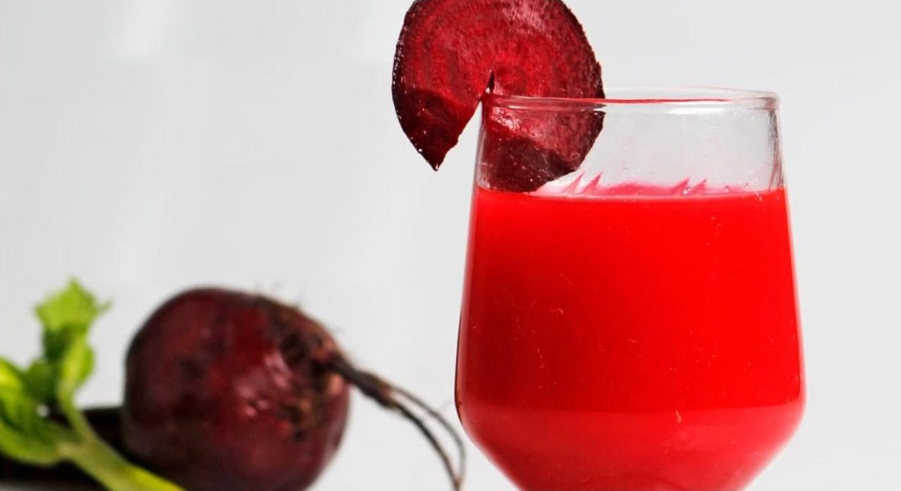
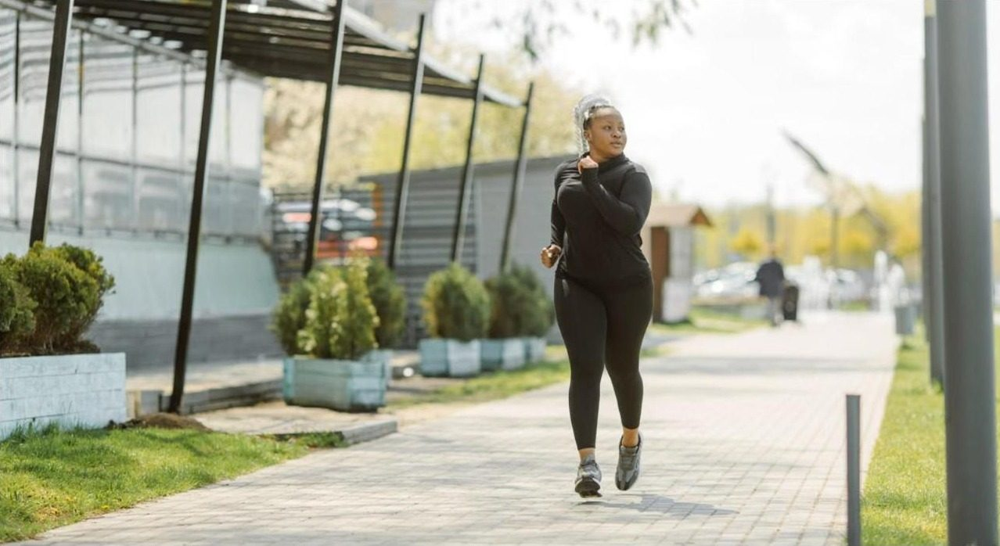
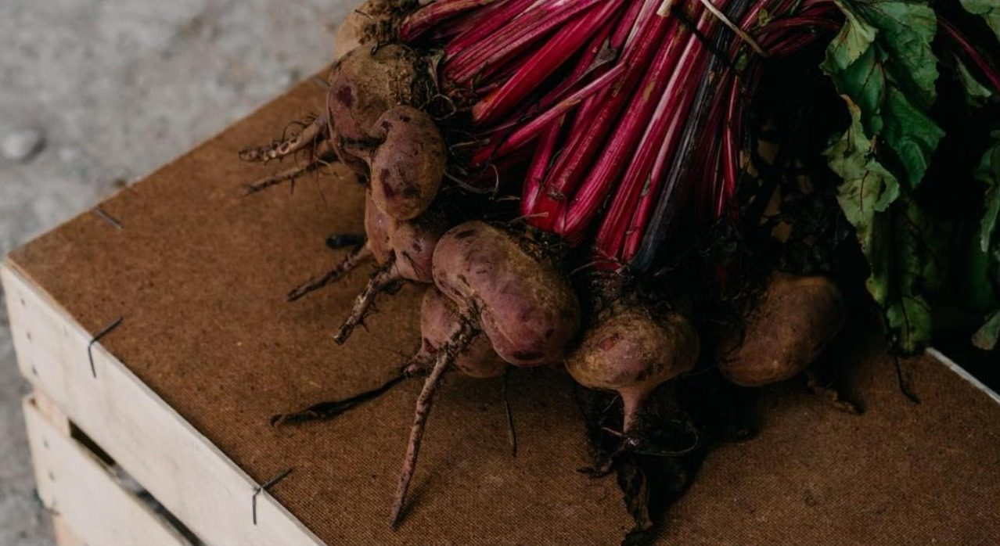

For years, people at our clinic have asked me the same question: "Daktari, what can I eat every day to feel stronger and look after my heart?"

Beetroot (*kiazi sukari*) is one of the foods I mention most often. It is cheap, it grows well in East Africa, and, unlike many "superfoods" you see advertised, it has solid research behind it. But the research also has limits, and the details matter: how much you eat, when you eat it, and even whether you use mouthwash.

Here is what I tell my clients.

## The Secret Is Nitrate, Not the Red Colour

Beetroot gets its deep red colour from pigments called betalains, which act as antioxidants. But its best-studied benefit comes from something you cannot see: **dietary nitrate**.

This is how it works:

1. You eat or drink beetroot, and the nitrate is absorbed into your blood.
2. Some of it returns to your mouth in your saliva, where **friendly bacteria on your tongue** turn it into nitrite.
3. Your body then turns nitrite into **nitric oxide**, a natural signal that helps blood vessels relax and widen.

Relaxed, wider blood vessels can mean slightly lower blood pressure and better delivery of oxygen to your muscles.

One surprising detail: because your mouth bacteria do part of the work, **strong antibacterial mouthwash can cancel much of the effect**. In studies, blood pressure went back up when volunteers used it. Keep brushing your teeth as normal, but avoid antibacterial mouthwash around the time you have your beetroot.

## 1. Blood Pressure: The Strongest Evidence

When researchers pooled the results of many controlled trials, beetroot juice lowered the top number of blood pressure (systolic) by about **3.5 mmHg** and the bottom number (diastolic) by about **1.3 mmHg** on average. In people who already had high blood pressure, the top number fell further, by around **5 mmHg**. Trials lasting two weeks or more showed bigger effects than single doses.

That may sound small. It is not. Large studies of blood-pressure treatment show that every 5 mmHg fall in the top number is linked with roughly a **10% lower risk of heart attack and stroke**.

To be honest with you: not every study found a benefit, and the effect is smaller if your blood pressure is already normal. Beetroot is a helpful food habit. It works best alongside less salt, more vegetables, regular movement and, if you have been prescribed them, your medicines. **It is never a replacement for them.**

## 2. Energy and Stamina

Nitrate helps your muscles do the same work using slightly less oxygen. Sports scientists, including the Australian Institute of Sport, list beetroot juice among the few supplements with good evidence. Their guidance is about **350–600 mg of nitrate taken 2–3 hours before exercise**, or daily for several days. The benefit shows most in efforts lasting about 4 to 30 minutes: a brisk walk uphill, a game of football or a run.

You do not need to be an athlete. Many people simply find that a long walk, climbing stairs or carrying shopping feels a little easier.

## 3. Other Benefits (and One Claim to Ignore)

- **Digestion:** about 2.8 g of fibre per 100 g supports gut health and regular bowel movements.
- **Folate and potassium:** one medium beetroot gives a good share of your daily folate, and potassium helps balance the effect of salt.
- **Liver and inflammation:** beetroot contains betaine and betalains, which are being studied for liver health and inflammation. The early results are promising, but still early.
- **Weight management:** only about 43 calories per 100 g, with plenty of fibre and water, so it fills you up.
- **Cancer:** you may read that beetroot "fights cancer." Some laboratory studies on cells and animals are interesting, but **there is no proof that beetroot prevents or treats cancer in people.**

## How Much Beetroot, and When?

You do not need huge amounts. Research trials mostly used **70–250 ml of beetroot juice a day**. In practice, I suggest:

- **Everyday serving:** 1 medium beetroot (about 150 g), or 1 glass (about 250 ml) of juice made with at least 1 medium beetroot.
- **Before exercise:** about 2 medium beetroots made into 150–200 ml of strong juice, 2–3 hours before you start.

Have it **every day**. The effects of nitrate fade within a few days once you stop, so consistency matters more than quantity. Raw and juiced beetroot keep the most nitrate. If you boil it, leave the skin on and use the cooking water in soup.

No juicer? Blend a chopped beetroot with a carrot and a cup of water, then strain it through a clean cloth. It works very well.

## Who Should Be Careful

For most people, beetroot is a safe everyday food. Talk to your doctor first if you:

- **Have had kidney stones.** Beetroot, and even more its leaves, are high in oxalate.
- **Have low blood pressure** or take **blood-pressure medicines**. Do not stop your medicine; ask your doctor to check your readings.
- **Take nitrate heart medicines or erection medicines** (such as sildenafil). These also work through nitric oxide.
- **Have diabetes.** Choose whole beetroot and vegetable juices over large glasses of sweet fruit-and-beet juice.
- **Have kidney disease.** Beetroot is high in potassium.

**Pink urine?** About 1 in 10 people notice pink or red urine or stool after eating beetroot. It is called beeturia and it is harmless. But if you see black, tarry stool, or blood when you have *not* eaten beetroot, see a doctor straight away.

## Why I Created a 30-Day Beetroot Plan

Knowing a food is good for you is not the same as eating it. Most people buy beetroot once, are not sure what to do with it, and it goes soft at the back of the fridge.

So I put together **The 30-Day Beetroot Plan**, a practical kit that tells you exactly what to make, how much to have and when:

- A **42-page guide** with the research explained simply, safety advice, and a day-by-day plan in four weeks (start gently, build energy, stamina and movement, make it a habit)
- **20 easy recipes** with East African ingredients: juices, smoothies, beetroot kachumbari, coconut curry, pink rice, lentil stew and more
- A **30-day tracker** (Excel and printable) that works out your weekly averages for energy, sleep and blood pressure
- **Weekly shopping lists**, **printable recipe cards** and a **meal planner**

It is available in **English** and in a full **Kiswahili edition**.

**[Get The 30-Day Beetroot Plan on Gumroad](https://wellbiz8.gumroad.com/l/30-day-beetroot-plan)** or **[on Payhip](https://payhip.com/b/7pIft)**

## Frequently Asked Questions

**Does beetroot really lower blood pressure?** Studies show a modest average drop of about 3.5 mmHg in the top number, and more in people with high blood pressure, especially when beetroot is taken daily for two weeks or longer. It supports, but does not replace, medical treatment.

**How much beetroot should I eat a day?** About one medium beetroot (150 g), or one glass (about 250 ml) of juice made with at least one medium beetroot, is similar to the amounts used in research.

**When is the best time to drink beetroot juice?** Any time for everyday health. For stamina, drink it 2–3 hours before a walk, run or game.

**Is it normal for my urine to turn pink after eating beetroot?** Yes. This is called beeturia and is harmless. See a doctor if you notice black stool or blood when you have not eaten beetroot.

**Can I stop my blood-pressure medicine if I drink beetroot juice?** No. Never stop or reduce a prescribed medicine on your own. If your readings improve, discuss it with your doctor.

*Sources: meta-analyses of randomised trials of beetroot juice and blood pressure; Blood Pressure Lowering Treatment Trialists' Collaboration (The Lancet, 2021); Australian Institute of Sport supplement framework (dietary nitrate); USDA food composition data.*

*Herbal Impact is a traditional and alternative medicine clinic licensed by Tanzania's Traditional and Alternative Health Practice Council. This article is for general information and does not replace advice from a qualified health worker.*
