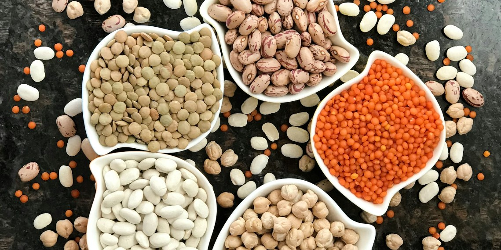

Two people can share the same birthday and still be years apart inside. One climbs stairs easily, sleeps well and rarely falls sick. The other gets tired quickly, takes several medicines and looks older than their years.

The difference is their **biological age**: how old the body really is inside, as opposed to the number of birthdays you have had. The good news from research is that biological age is not fixed. Your daily habits help decide how fast your body's aging clock ticks. In this article I explain what biological age is, how scientists measure it, and which habits the evidence links to slower aging.

## What Is Biological Age?

Your **calendar age** counts the years since you were born. Your **biological age** reflects the condition of your cells, blood vessels, muscles and organs. Someone who is 50 by the calendar may have the body of a 45-year-old, or of a 60-year-old.

Scientists now have several ways to estimate it:

- **Epigenetic clocks.** Your DNA carries tiny chemical tags that switch genes on and off. Their pattern changes with age in a predictable way, so a blood test can read it and estimate your biological age or how fast you are aging.
- **Telomeres.** These are protective caps on the ends of your chromosomes, like the plastic tips on shoelaces. They shorten as cells divide, and shorter telomeres are linked to older biological age.
- **Everyday body markers.** Blood pressure, blood sugar, cholesterol, waist size and muscle strength all give clues about how well the body is aging.

## What the Research Shows

Your genes play a part, but lifestyle has a large say. A few important studies:

- **Eating a little less.** In the CALERIE trial, healthy adults who reduced their calorie intake for two years slowed their pace of aging by about 2 to 3 per cent, measured with an epigenetic clock (*Nature Aging*, 2023). The researchers note that an effect of this size has been linked in other studies to a 10 to 15 per cent lower risk of death.
- **Omega-3 from fish.** In the three-year DO-HEALTH trial in older adults, omega-3 supplements slowed several epigenetic clocks by up to about four months. Combining omega-3, vitamin D and simple home exercise gave the biggest benefit (*Nature Aging*, 2025).
- **Staying active.** A study of 5,823 US adults found that highly active people had telomeres equivalent to about nine years less cellular aging than inactive people (*Preventive Medicine*, 2017).

Let us be honest about the size of these effects: they are real but modest, often measured in months over a few years. But they add up, they work together, and the same habits also lower your risk of heart disease, diabetes, stroke and some cancers.

## Seven Habits That Slow Your Aging Clock

**1. Move every day.** Aim for at least 150 minutes of brisk walking or similar activity a week, the World Health Organization's minimum. Brisk means you can talk but not sing.

**2. Keep your muscles strong.** Two short strength sessions a week (sit-to-stands from a chair, wall push-ups, heel raises) protect your blood sugar, bones and balance. No gym is needed.

**3. Eat mostly plants.** Fill half your plate with vegetables and fruit. Eat beans, lentils or other legumes most days, and choose whole grains like millet, sorghum, oats and brown rice over refined white flour.

**4. Eat oily fish twice a week.** Sardines, dagaa, mackerel and salmon all count, whether fresh, frozen or canned.

**5. Sleep 7 to 9 hours.** Keep regular sleeping and waking times. Short, irregular sleep is linked to faster aging.

**6. Avoid tobacco and limit alcohol.** Smoking is one of the strongest accelerators of biological aging. Heavy drinking is consistently linked to an older biological age.

**7. Manage stress and stay connected.** Long-term stress is linked to shorter telomeres, and loneliness to poorer health. A few minutes of calm breathing each day, and regular time with people who matter to you, both help.

## Where Do You Stand? A Quick Waist Check

One simple marker you can check at home is your waist. Measure around your waist at the level of your belly button, breathing out normally, and compare it with your height. **Keeping your waist under half your height** is a widely used healthy target. If you are above it, the habits above are a good place to start.

## Turn This Into a 30-Day Plan

Knowing what to do is one thing; doing it every day is another. That is why I wrote **Slow Your Aging Clock: A 30-Day Science-Based Plan to Lower Your Biological Age**, an illustrated guide that turns this research into one small action a day. Inside you will find:

- The **Aging Clock Scorecard**, to see where you stand on Day 1 and how far you have come by Day 30
- A **4-week step-by-step plan** covering sleep, movement, food, strength, stress and connection
- A **food guide** with a budget swap table, a 7-day meal plan and a shopping list, using foods found almost anywhere
- A simple **home strength routine** and printable **trackers**

The guide costs **US$15** and is available in English and in a full Kiswahili edition. The **Premium Kit (US$29)** adds 30 slow-aging recipes, an interactive Excel tracker and editable Word tools.

**[Get the guide on Gumroad](https://wellbiz8.gumroad.com/l/cdqley)** or **[on Payhip](https://payhip.com/b/4nIXY)**

**[Get the Premium Kit on Gumroad](https://wellbiz8.gumroad.com/l/jbuoxa)** or **[on Payhip](https://payhip.com/b/0t6zb)**

## Frequently Asked Questions

**What is the difference between biological age and calendar age?** Calendar age is the number of years since you were born. Biological age reflects how well your cells and organs are holding up, and it can be younger or older than your calendar age depending on genes and lifestyle.

**Can you really lower your biological age?** Research shows that healthy habits can slow the pace of biological aging, and some studies suggest certain markers improve. The effects of single changes are modest, but combining several habits over years makes the biggest difference.

**How can I find out my biological age?** Only a laboratory test, such as an epigenetic clock blood test, can estimate it directly. At home, simple markers like waist-to-height ratio, blood pressure, blood sugar and fitness give useful clues.

**Do supplements reverse aging?** No supplement has strong proof that it reverses aging. Be cautious of anyone who promises that. Food, movement, sleep and avoiding tobacco have far better evidence.

## Contact Us

For more information or a consultation, call or WhatsApp **+255 754 281 131** / **+255 655 281 131**, or visit us at **Mosque Street, Kitumbini, Dar es Salaam**.

*Sources: Waziry et al., Effect of long-term caloric restriction on DNA methylation measures of biological aging in healthy adults from the CALERIE trial (Nature Aging, 2023); Bischoff-Ferrari et al., Individual and additive effects of vitamin D, omega-3 and exercise on DNA methylation clocks of biological aging in older adults from the DO-HEALTH trial (Nature Aging, 2025); Tucker, Physical activity and telomere length in U.S. men and women (Preventive Medicine, 2017); World Health Organization, Guidelines on physical activity and sedentary behaviour (2020).*

*This article is for general education and is not medical advice. Herbal Impact is licensed by Tanzania's Traditional and Alternative Health Practice Council. If you are on medical treatment, keep taking it and speak to your doctor before changing your diet or exercise routine.*
