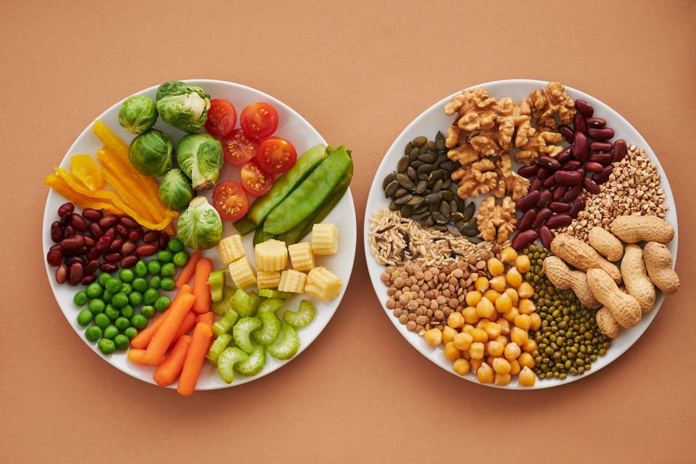

If you live with diabetes, you have probably been told to "watch what you eat". But what does that really mean at the dinner table? Should you stop eating rice? Is fruit allowed? Is brown bread better than white?

The most practical answer I know comes from a simple tool called the **Glycemic Index (GI)**. Once you understand glycemic index foods for diabetes, choosing what to eat stops being guesswork. This article explains the basics, and at the end I will tell you about a complete guide I have written to help you put it all into practice.

## Why Food Matters So Much in Diabetes

When you eat starch or sugar, your body turns it into glucose, which enters your blood. A hormone called insulin moves that glucose into your cells. In type 2 diabetes, the most common type, the cells stop responding well to insulin, so glucose stays in the blood.

Blood sugar that stays high for years slowly damages blood vessels and nerves. That is how diabetes leads to heart disease, stroke, kidney failure, eye damage and foot wounds that will not heal.

Modern medicines help a great deal, and many people need them. But medicine has limits, and some medicines bring side effects after years of use. In my experience, **the most powerful long-term tool is the food on your plate**, because it decides how fast and how high your sugar rises after every single meal.

## What Is the Glycemic Index?

The Glycemic Index ranks foods that contain carbohydrate on a scale from 0 to 100, according to how quickly they raise blood sugar compared with pure glucose (GI 100).

- **Low GI (55 or less):** digested slowly; blood sugar rises gently. Examples: beans, lentils, chickpeas, barley, rolled oats, apples, oranges, milk.
- **Medium GI (56 to 69):** a moderate rise. Examples: brown rice, sweet potato, couscous, pineapple.
- **High GI (70 or more):** digested fast; sugar shoots up. Examples: white bread, boiled white rice, boiled potatoes, cornflakes, instant oats, watermelon.

The idea is simple: build most of your meals on low-GI foods, eat medium-GI foods in sensible portions, and keep high-GI foods small and occasional.

## Three Surprises About GI

**1. "Brown" does not always mean low GI.** Wholemeal bread (GI 74) raises blood sugar almost as fast as white bread (GI 75). Bread with whole grains and seeds (GI about 53) is a much better choice.

**2. How you cook it matters.** Instant oats have a GI of 79, while porridge made from rolled oats is about 55. Pasta cooked firm has a lower GI than soft, overcooked pasta. Green bananas (about 37) are far gentler than very ripe ones.

**3. What you eat with it matters even more.** Research on traditional foods in Kenya found that boiled white rice alone had a GI of 77, but rice eaten **with beans** dropped to 62. Whole-maize stiff porridge (ugali) alone scored 62, but with cooked cowpea leaves the meal fell to 45. Protein, vegetables and fibre slow everything down.

## The One Food Group I Recommend Every Day

If I could give a person with diabetes only one piece of food advice, it would be: **eat legumes every day.** Beans, lentils, chickpeas, green peas, mung beans, cowpeas and pigeon peas mostly have a GI between about 15 and 45. They are filling, rich in protein and fibre, cheap, and available almost everywhere in the world.

Simple ways to start:

1. Replace half the rice on your plate with beans or lentils.
2. Start your main meal with a small bowl of bean or lentil soup.
3. Snack on a few nuts or roasted chickpeas instead of biscuits.
4. Fill half your plate with vegetables, a quarter with protein and a quarter with a low-GI starch.

## Important: Talk to Your Doctor Before Changing Medicine

When you start eating this way, your blood sugar may fall. That is good news, but if you use insulin or tablets such as glibenclamide or gliclazide, it can fall too low. **Never stop or reduce diabetes medicine on your own.** Check your sugar more often and let your doctor adjust your dose.

## Get the Complete Guide: The Diabetes Food Guide

To make all of this easy to use every day, I have written **The Diabetes Food Guide: Eat Smart with the Glycemic Index**, a 23-page illustrated PDF for people with type 2 diabetes or prediabetes and the families who cook for them, wherever they live. Inside you will find:

- A **GI table of more than 70 everyday foods** from around the world, colour-coded low, medium and high
- The **plate method** and a table of **smart food swaps**
- A **7-day low-GI meal plan**
- **Six easy recipes** built on beans, lentils, chickpeas and greens
- Daily habits that lower blood sugar, how to recognise and treat **low blood sugar**, a **shopping list** and a one-page **quick-reference card**

It costs **US$7.55** and is available in English and in a full Kiswahili edition.

**[Get The Diabetes Food Guide on Gumroad](GUMROAD_LINK_EN)** or **[on Payhip](PAYHIP_LINK_EN)**

Alongside good food and medical care, some of our clients also use **Haiiba GlucoMaster Extra**, a herbal product from Herbal Impact. Ask us about it, and tell your doctor about any herbal product you take.

## Frequently Asked Questions

**What are the best low glycemic foods for diabetes?** Legumes (beans, lentils, chickpeas), non-starchy vegetables, barley, rolled oats, whole fruits such as apples and oranges, milk, plain yoghurt and nuts are among the best choices. Combine starchy foods with vegetables and protein to lower the effect of the whole meal.

**Can people with diabetes eat rice?** Yes, in smaller portions and ideally mixed with beans or lentils, with plenty of vegetables. White rice on its own has a high GI, so avoid large plates of plain rice.

**Is fruit safe for people with diabetes?** Most whole fruits have a low GI and are a good choice in normal portions. Watermelon and very ripe fruit raise sugar faster, and fruit juice is best avoided.

**Can a low-GI diet replace diabetes medicine?** No. It supports treatment and may help your doctor lower your dose over time, but never stop or change medicine without medical advice. See a doctor for very high readings, repeated low sugar, foot wounds or changes in vision.

## Contact Us

For more information or a consultation, call or WhatsApp **+255 754 281 131** / **+255 655 281 131**, or visit us at **Mosque Street, Kitumbini, Dar es Salaam**.

*Sources: Atkinson, Foster-Powell and Brand-Miller, International tables of glycemic index and glycemic load values: 2008 (Diabetes Care); Ebere, Imungi and Kimani, Glycemic index values of traditional Kenyan foods (African Health Sciences, 2021); Henry et al., A glycaemic index compendium of non-Western foods (Nutrition & Diabetes, 2021); American Diabetes Association, Diabetes Plate Method.*

*Herbal Impact is licensed by Tanzania's Traditional and Alternative Health Practice Council. If you are on medical treatment, keep taking it and tell your doctor about any herbal products you use.*
