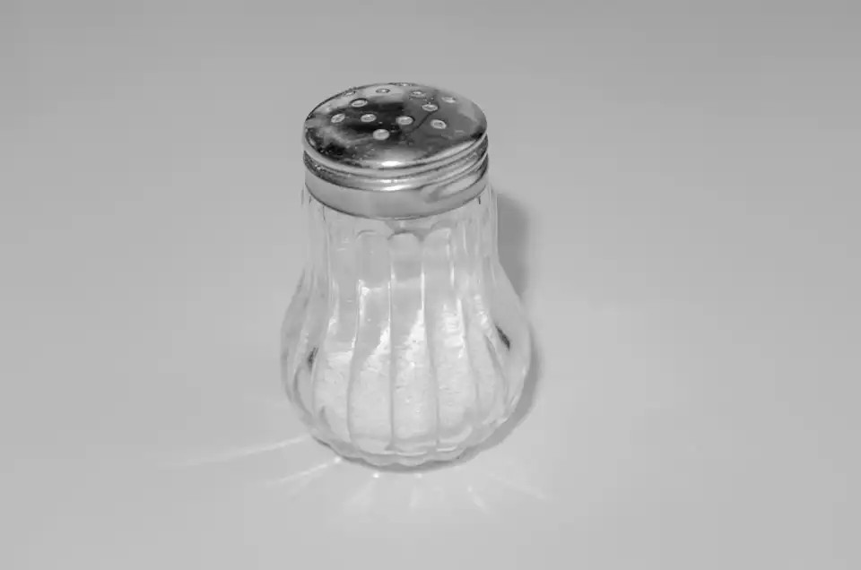

High blood pressure is called the **"silent killer"** for a reason. It rarely causes symptoms, yet year after year it strains the heart, brain, kidneys and eyes. The World Health Organization estimates that **1.4 billion adults** aged 30 to 79 had high blood pressure in 2024, and fewer than 1 in 4 had it under control. Nearly half did not know they had it.

The good news is that blood pressure responds strongly to everyday habits. The **2025 American Heart Association and American College of Cardiology guideline** puts lifestyle change at the centre of prevention and treatment for everyone. In this article I share seven ways to lower your blood pressure naturally, with the typical drop that research has found for each one.

## First, Know Your Numbers

A reading such as **128/82 mmHg** has two parts. The top number (systolic) is the pressure when your heart beats; the bottom number (diastolic) is the pressure between beats.

- **Normal:** below 120/80
- **Elevated:** 120–129 and below 80
- **Stage 1 high blood pressure:** 130–139 or 80–89
- **Stage 2 high blood pressure:** 140/90 or higher
- **Severe:** 180/120 or higher. Measure again after 5 minutes and see a doctor the same day if it stays that high.

Many guidelines, including the WHO's, diagnose hypertension from 140/90. Either way, lower is healthier, and the steps below help at every level.

## 1. Cut Salt to Less Than One Teaspoon a Day

Too much salt makes the body hold on to water, which raises the pressure in your blood vessels. The WHO recommends **less than 5 grams of salt a day**, about one level teaspoon from all sources. Most adults eat about twice that.

Much of the salt is hidden in **stock cubes, seasoning powders, salted or dried fish, processed meats, crisps, instant noodles, bread and sauces**. Flavour your food with garlic, ginger, onion, lemon and spices instead, and take the salt shaker off the table. Your taste buds adjust within two to three weeks. **Typical drop: about 5–6 mmHg in people with high blood pressure.**

## 2. Eat the DASH Way, With More Potassium

The DASH eating pattern (Dietary Approaches to Stop Hypertension) is one of the best-tested diets in medicine. Fill half your plate with vegetables and fruit, eat beans or lentils most days, choose whole grains such as brown rice, dona or millet, and have fish twice a week.

Potassium helps the body remove sodium. Good sources include **bananas, avocado, beans, sweet potatoes, leafy greens such as mchicha, tomatoes and oranges**. **Typical drop with DASH: up to about 11 mmHg in people with high blood pressure.** (If you have kidney disease, ask your doctor before eating a high-potassium diet.)

## 3. Try the Wall Sit: The Exercise Research Ranked Best

In 2023, the *British Journal of Sports Medicine* analysed **270 trials involving nearly 16,000 people**. Every type of exercise helped, but **isometric exercise**, where you hold a position without moving, lowered blood pressure the most: about **8 mmHg (top) and 4 mmHg (bottom)**. The single most effective exercise was the **wall sit**.

**How to do it:** lean your back against a wall and slide down until your knees are bent, as if sitting on an invisible chair. Hold for 2 minutes, breathing normally, then rest for 2 minutes. Do 4 holds, 3 times a week. Beginners can start with 30–60 seconds and stay higher. **Never hold your breath.** If your blood pressure is 160/100 or higher, or you have heart disease, check with your doctor first.

## 4. Walk Briskly for 30 Minutes Most Days

The 2025 guideline recommends at least 75–150 minutes of activity a week. Brisk walking for 30 minutes on five days is a simple target; "brisk" means you can talk but not sing. **Typical drop from aerobic exercise: about 4–5 mmHg.**

## 5. Lose a Little Weight if You Need To

Weight loss is one of the strongest lifestyle tools. Blood pressure falls by roughly **1 mmHg for every kilogram** of excess weight lost, so even 3–5 kg makes a difference.

## 6. Limit Alcohol and Stop Tobacco

If you drink, keep to no more than two drinks a day for men and one for women, with alcohol-free days. Less is better. Every cigarette raises blood pressure for a while and damages the arteries.

## 7. Calm Your Stress and Protect Your Sleep

Slow breathing, about six breaths a minute for 5–10 minutes a day, helps calm the nervous system. Aim for 7–9 hours of sleep. Loud snoring with pauses in breathing can be **sleep apnoea**, a common hidden cause of high blood pressure, so mention it to your doctor.

## Measure at Home, the Right Way

Home readings show whether your changes are working. Use an upper-arm monitor. Avoid tea, coffee, smoking and exercise for 30 minutes before, sit quietly for 5 minutes with your back supported and feet flat, and rest your arm on a table at heart level. Take two readings a minute apart, morning and evening, and write them down.

**Important:** if you take blood pressure medicine, keep taking it. Never stop or change the dose without your doctor, even when your readings improve.

## A 30-Day Plan You Can Follow at Home

To make this easy, I have written **Lower Blood Pressure Naturally: The 30-Day Plan: Foods, Exercises and Daily Habits Backed by Research**, an illustrated 19-page guide that includes:

- How to **read your numbers** and **measure correctly** at home
- The **7 proven levers** and how much each one lowers blood pressure
- A **salt detective** section and DASH eating with everyday East African foods
- The **wall-sit routine** step by step, plus a walking plan
- A **day-by-day 30-day plan**, a daily habit checklist and printable blood pressure logs

The guide costs **US$15** and is available in English and in a full Kiswahili edition. The **Premium Kit (US$29)** adds 24 low-salt recipes, an Excel tracker that calculates your averages and charts your progress, and editable Word tools.

**[Get the guide on Gumroad](https://wellbiz8.gumroad.com/l/inwggi)** or **[on Payhip](https://payhip.com/b/z1bkX)**

**[Get the Premium Kit on Gumroad](https://wellbiz8.gumroad.com/l/ficmcy)** or **[on Payhip](https://payhip.com/b/97Axt)**

## Frequently Asked Questions

**How fast can I lower my blood pressure naturally?** Many people see their home average start to fall within 2 to 4 weeks of cutting salt, eating more vegetables and exercising regularly. The full effect builds over a few months.

**Can I stop my blood pressure medicine if I change my lifestyle?** Do not stop on your own. Lifestyle changes may allow your doctor to lower the dose or number of medicines over time, but that decision must be made with your doctor.

**What is the best exercise to lower blood pressure?** All regular exercise helps. A large 2023 analysis found isometric exercise, especially the wall sit, gave the biggest average drop, and brisk walking is an excellent daily foundation.

**Which foods lower blood pressure?** Vegetables and fruit, beans and lentils, whole grains, low-fat milk or mtindi, and potassium-rich foods such as bananas, avocado and sweet potatoes. Beetroot and leafy greens are rich in natural nitrates that help blood vessels relax.

## Contact Us

For more information or a consultation, call or WhatsApp **+255 754 281 131** / **+255 655 281 131**, or visit us at **Mosque Street, Kitumbini, Dar es Salaam**.

*Sources: WHO Global Report on Hypertension (2025); Jones et al., 2025 AHA/ACC Guideline for the Prevention, Detection, Evaluation and Management of High Blood Pressure in Adults; Edwards et al., Exercise training and resting blood pressure: a network meta-analysis (Br J Sports Med, 2023); Neal et al., Salt Substitute and Stroke Study (N Engl J Med, 2021); Mayo Clinic, 10 ways to control high blood pressure without medication.*

*This article is for general education and is not medical advice. Herbal Impact is licensed by Tanzania's Traditional and Alternative Health Practice Council. If you are on medical treatment, keep taking it and speak to your doctor before starting a new exercise programme.*
