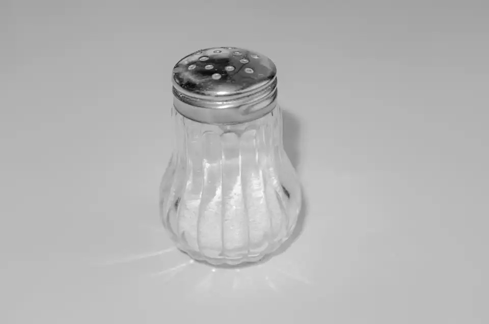

Presha ya kupanda huitwa **"muuaji wa kimya kimya"** kwa sababu nzuri. Mara nyingi haina dalili, lakini taratibu huharibu moyo, ubongo, figo na macho. Shirika la Afya Duniani (WHO) linakadiria kuwa mwaka 2024 **watu wazima bilioni 1.4** wenye umri wa miaka 30 hadi 79 walikuwa na presha ya kupanda, na chini ya mmoja kati ya wanne ndiye aliyekuwa ameidhibiti. Karibu nusu yao hawakujua kuwa wanayo.

Habari njema ni kwamba unaweza kushusha presha kwa kubadili tabia zako za kila siku. **Mwongozo wa mwaka 2025 wa Shirika la Moyo la Marekani (AHA) na Chuo cha Magonjwa ya Moyo cha Marekani (ACC)** unasema kuwa kubadili mtindo wa maisha ndiyo hatua ya kwanza kwa kila mtu, iwe anataka kuzuia presha au kuitibu. Katika makala hii nakueleza njia saba za kushusha presha kwa njia asilia, na kiasi ambacho tafiti zimeonyesha kila njia inavyoshusha.

## Kwanza, Jua Namba Zako

Kipimo kama **128/82 mmHg** kina sehemu mbili. Namba ya juu inaonyesha nguvu ya damu kwenye mishipa wakati moyo unapiga; namba ya chini inaonyesha nguvu hiyo wakati moyo unapumzika kati ya pigo moja na jingine.

- **Kawaida:** chini ya 120/80
- **Imeanza kupanda:** 120–129 na chini ya 80
- **Presha ya kupanda, hatua ya 1:** 130–139 au 80–89
- **Presha ya kupanda, hatua ya 2:** 140/90 au zaidi
- **Hatari kubwa:** 180/120 au zaidi. Pima tena baada ya dakika 5, na umwone daktari siku hiyo hiyo kama itabaki juu hivyo.

WHO na nchi nyingi huanza kuhesabu presha ya kupanda kuanzia 140/90. Kwa vyovyote vile, presha ikiwa chini ndivyo bora, na hatua zifuatazo zinamsaidia kila mtu.

## 1. Punguza Chumvi Isizidi Kijiko Kimoja Kidogo kwa Siku

Chumvi nyingi humfanya mwili ushikilie maji mengi, na hii huongeza nguvu ya damu kwenye mishipa, yaani presha. WHO inapendekeza **chini ya gramu 5 za chumvi kwa siku**, yaani kijiko kimoja kidogo cha chai bapa, ukijumlisha chumvi iliyomo kwenye vyakula vyote vya siku nzima. Watu wazima wengi hula karibu mara mbili ya kiasi hicho.

Sehemu kubwa ya chumvi imejificha kwenye **vidonge vya supu, unga wa kuongeza ladha, samaki au nyama za kukaushwa kwa chumvi, nyama za kusindika, chipsi za pakiti, tambi za papo hapo, mkate na sosi**. Ongeza ladha kwa kitunguu saumu, tangawizi, kitunguu, limau na viungo badala yake, na ondoa kichupa cha chumvi mezani. Baada ya wiki mbili hadi tatu ulimi huzoea. **Inashusha kwa wastani: takriban mmHg 5–6 kwa wenye presha ya kupanda.**

## 2. Fuata Mpango wa Ulaji wa DASH, na Kula Vyakula Vyenye Potasiamu

DASH ni mpango maalumu wa ulaji uliobuniwa kushusha presha, na ni mojawapo ya mipango ya chakula iliyofanyiwa tafiti nyingi zaidi duniani. Jaza nusu ya sahani kwa mboga na matunda, kula maharage au dengu siku nyingi, chagua nafaka zisizokobolewa kama mchele wa kahawia, dona au ulezi, na kula samaki mara mbili kwa wiki.

Potasiamu ni madini yanayosaidia mwili kutoa chumvi iliyozidi. Vyanzo vizuri ni **ndizi, parachichi, maharage, viazi vitamu, mboga za majani kama mchicha, nyanya na machungwa**. **DASH inashusha kwa wastani: hadi takriban mmHg 11 kwa wenye presha ya kupanda.** (Kama una ugonjwa wa figo, muulize daktari kabla ya kula vyakula vingi vyenye potasiamu.)

## 3. Jaribu Zoezi la Kuegemea Ukuta: Linashusha Presha Kuliko Mazoezi Mengine

Mwaka 2023, jarida la *British Journal of Sports Medicine* lilichambua **tafiti 270 zilizohusisha karibu watu 16,000**. Kila aina ya mazoezi ilisaidia, lakini **mazoezi ya kukaza misuli bila kusogea** (kushikilia mkao mmoja kwa muda) yalishusha presha zaidi: takriban **mmHg 8 (juu) na mmHg 4 (chini)**. Zoezi lililoshusha presha kuliko yote ni **kuegemea ukuta kama umekaa kwenye kiti kisichoonekana** (kwa Kiingereza "wall sit").

**Jinsi ya kulifanya:** egemeza mgongo ukutani kisha teremka taratibu hadi magoti yakunjike, kana kwamba umekaa kwenye kiti kisichoonekana. Shikilia kwa dakika 2 ukipumua kawaida, kisha pumzika dakika 2. Fanya mara 4, siku 3 kwa wiki. Kama ndiyo unaanza, kaa hivyo kwa sekunde 30–60 tu, ukishuka kidogo. **Usibane pumzi kamwe.** Kama presha yako ni 160/100 au zaidi, au una ugonjwa wa moyo, wasiliana na daktari kwanza.

## 4. Tembea Haraka Dakika 30 Siku Nyingi

Mwongozo wa 2025 unapendekeza angalau dakika 75–150 za mazoezi kwa wiki. Kutembea haraka dakika 30 siku tano ni lengo rahisi; "haraka" maana yake unaweza kuongea lakini huwezi kuimba. **Inashusha kwa wastani: takriban mmHg 4–5.**

## 5. Punguza Uzito Kidogo Kama Unahitaji

Kupunguza uzito ni mojawapo ya njia zinazosaidia zaidi. Presha hushuka kwa takriban **mmHg 1 kwa kila kilo** ya uzito uliozidi inayopunguzwa, hivyo hata kilo 3–5 huleta tofauti.

## 6. Punguza Pombe na Acha Tumbaku

Kama unakunywa, usizidishe vinywaji viwili kwa siku kwa wanaume na kimoja kwa wanawake, na uwe na siku zisizo na pombe. Kidogo ndivyo bora zaidi. Kila sigara hupandisha presha kwa muda na kuharibu mishipa.

## 7. Tuliza Msongo wa Mawazo na Linda Usingizi Wako

Kupumua taratibu husaidia kutuliza mwili: vuta pumzi kwa sekunde 4, itoe taratibu kwa sekunde 6, kwa dakika 5–10 kila siku. Lenga kulala saa 7–9. Kukoroma kwa nguvu huku pumzi ikikatika kunaweza kuwa **tatizo la pumzi kukatika usingizini (sleep apnoea)**, ambalo huchangia presha ya kupanda bila watu wengi kujua. Mjulishe daktari wako.

## Pima Nyumbani kwa Njia Sahihi

Ukijipima nyumbani utaona kama mabadiliko unayofanya yanasaidia. Tumia kipimo chenye mkanda wa juu ya mkono. Usinywe chai wala kahawa, usivute sigara wala kufanya mazoezi dakika 30 kabla; kaa kimya dakika 5 mgongo ukiwa umeegemea na nyayo sakafuni, na weka mkono mezani usawa wa moyo. Pima mara mbili kwa tofauti ya dakika moja, asubuhi na jioni, na uandike matokeo.

**Muhimu:** kama unatumia dawa za presha, endelea kuzitumia. Kamwe usiziache au kubadilisha dozi bila daktari wako, hata presha ikishuka.

## Mpango wa Siku 30 Unaoweza Kuufuata Nyumbani

Ili kukurahisishia, nimeandika kitabu **Shusha Presha kwa Njia Asilia: Mpango wa Siku 30: Vyakula, Mazoezi na Tabia za Kila Siku Zinazothibitishwa na Tafiti**, kitabu chenye picha cha kurasa 19 kinachojumuisha:

- **Maana ya namba za presha yako**, na jinsi ya **kujipima nyumbani bila makosa**
- **Njia 7 zilizothibitishwa na tafiti**, na kiasi kila njia inavyoshusha presha
- Jinsi ya **kugundua chumvi iliyojificha** kwenye vyakula, na mpango wa ulaji wa DASH kwa vyakula vyetu vya kila siku
- **Zoezi la kuegemea ukuta** hatua kwa hatua, pamoja na mpango wa kutembea
- **Mpango wa siku 30** unaoeleza cha kufanya kila siku, pamoja na majedwali ya kujaza vipimo na tabia zako

Kitabu kinauzwa **US$15** na kinapatikana kwa Kiswahili na kwa Kiingereza. **Kifurushi cha Premium (US$29)** kinaongeza mapishi 24 yasiyoongezwa chumvi, jedwali la Excel linalokuhesabia wastani wa presha yako na kuonyesha maendeleo kwa chati, na fomu za Word za kujaza.

**[Pata kitabu kupitia Payhip](https://payhip.com/b/fG5HF)** au **[kupitia Gumroad](https://wellbiz8.gumroad.com/l/xjkys)**

**[Pata Kifurushi cha Premium kupitia Payhip](https://payhip.com/b/Akd2n)** au **[kupitia Gumroad](https://wellbiz8.gumroad.com/l/cntph)**

## Maswali Yanayoulizwa Mara kwa Mara

**Ninaweza kushusha presha kwa njia asilia kwa muda gani?** Watu wengi huona wastani wao wa nyumbani ukianza kushuka ndani ya wiki 2 hadi 4 baada ya kupunguza chumvi, kula mboga zaidi na kufanya mazoezi mara kwa mara. Matokeo kamili huongezeka ndani ya miezi michache.

**Naweza kuacha dawa za presha nikibadilisha mtindo wa maisha?** Usiache mwenyewe. Mabadiliko ya maisha yanaweza kumwezesha daktari wako kupunguza dozi au idadi ya dawa baada ya muda, lakini uamuzi huo lazima ufanywe pamoja na daktari.

**Zoezi gani bora la kushusha presha?** Mazoezi yote ya mara kwa mara husaidia. Uchambuzi mkubwa wa mwaka 2023 ulionyesha kuwa mazoezi ya kukaza misuli bila kusogea, hasa kuegemea ukuta, ndiyo yaliyoshusha presha zaidi. Kutembea haraka nako ni zoezi zuri la kila siku.

**Vyakula gani hushusha presha?** Mboga na matunda, maharage na dengu, nafaka zisizokobolewa, maziwa yenye mafuta kidogo au mtindi, na vyakula vyenye potasiamu kama ndizi, parachichi na viazi vitamu. Kiazi sukari (beetroot) na mboga za majani vina kemikali asilia (nitreti) zinazosaidia mishipa ya damu kulegea.

## Wasiliana Nasi

Kwa maelezo zaidi au ushauri, piga simu au WhatsApp **0754 281 131** / **0655 281 131**, au tutembelee **Mtaa wa Mosque, Kitumbini, Dar es Salaam** (mkabala na msikiti wa Sunni).

*Vyanzo: Ripoti ya Dunia ya WHO kuhusu Presha (2025); Jones na wenzake, 2025 AHA/ACC Guideline for the Prevention, Detection, Evaluation and Management of High Blood Pressure in Adults; Edwards na wenzake, Exercise training and resting blood pressure: a network meta-analysis (Br J Sports Med, 2023); Neal na wenzake, Salt Substitute and Stroke Study (N Engl J Med, 2021); Mayo Clinic, 10 ways to control high blood pressure without medication.*

*Makala hii ni kwa ajili ya elimu ya jumla na si ushauri wa kitabibu. Herbal Impact imesajiliwa na Baraza la Tiba Asili na Tiba Mbadala la Tanzania. Kama uko kwenye matibabu, endelea nayo na zungumza na daktari wako kabla ya kuanza programu mpya ya mazoezi.*
