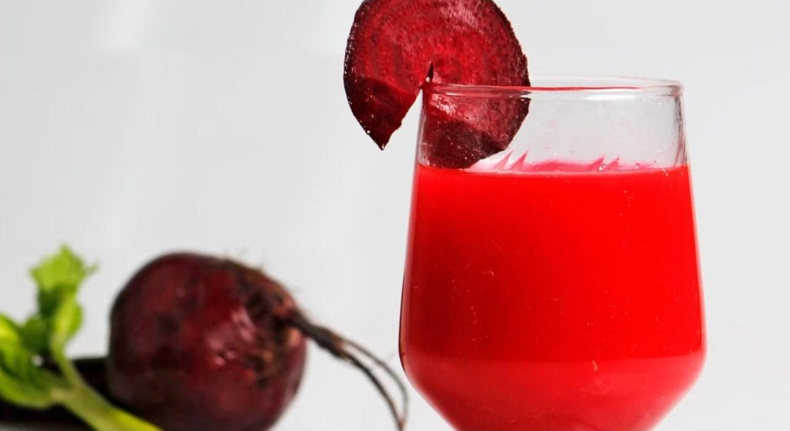
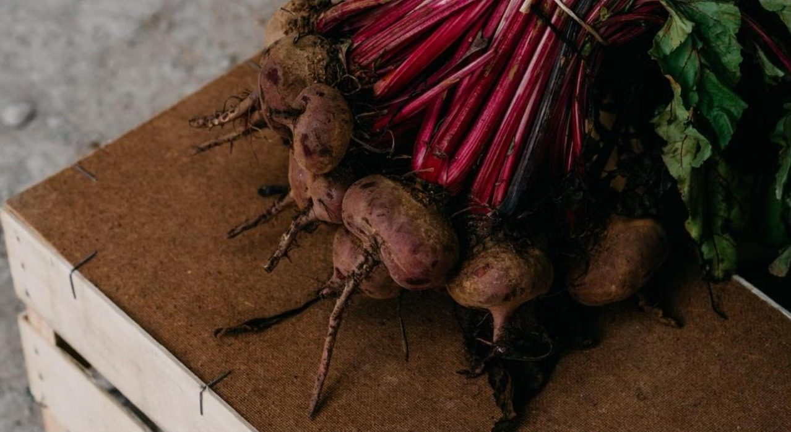

Kwa miaka mingi, watu wanaofika kliniki kwetu wamekuwa wakiniuliza swali moja: "Daktari, nile nini kila siku ili nijisikie mwenye nguvu na kulinda moyo wangu?"

Kiazi sukari (*beetroot*) ni mojawapo ya vyakula ninavyovitaja mara nyingi. Ni cha bei nafuu, kinastawi vizuri hapa Afrika Mashariki, na tofauti na "vyakula vya maajabu" vingi vinavyotangazwa, kina tafiti za kuaminika. Lakini tafiti hizo pia zina mipaka yake, na mambo madogo yana uzito: kiasi unachokula, muda unaokula, na hata kama unatumia dawa ya kusukutua kinywa.

Haya ndiyo ninayowaeleza wateja wangu.

## Siri Iko Kwenye Nitrati, Si Kwenye Rangi Nyekundu

Rangi nyekundu iliyokolea ya kiazi sukari inatokana na viini vinavyoitwa betalaini, ambavyo hufanya kazi ya kulinda seli (antioxidants). Lakini faida yake iliyochunguzwa zaidi inatokana na kitu kisichoonekana kwa macho: **nitrati**.

Inavyofanya kazi ni hivi:

1. Unakula au kunywa kiazi sukari, na nitrati inaingia kwenye damu.
2. Sehemu yake inarudi kinywani kupitia mate, na **bakteria rafiki walio kwenye ulimi** wanaigeuza kuwa nitraiti.
3. Mwili unaigeuza nitraiti kuwa **nitriki oksaidi**, ishara ya asili inayosaidia mishipa ya damu kulegea na kupanuka.

Mishipa iliyolegea na kupanuka inaweza kumaanisha presha kushuka kidogo, na oksijeni kufika kwa urahisi zaidi kwenye misuli.

Jambo moja la kushangaza: kwa kuwa bakteria wa kinywani wanafanya sehemu ya kazi hii, **dawa kali za kusukutua zinazoua bakteria zinaweza kufuta sehemu kubwa ya faida hii**. Kwenye tafiti, presha ilipanda tena washiriki walipozitumia. Endelea kupiga mswaki kama kawaida, ila epuka dawa hizo za kusukutua karibu na muda wa kutumia kiazi sukari.

## 1. Shinikizo la Damu: Ushahidi Wenye Nguvu Zaidi

Watafiti walipounganisha matokeo ya majaribio mengi, juisi ya kiazi sukari ilishusha namba ya juu ya presha (systolic) kwa wastani wa **takriban 3.5 mmHg**, na namba ya chini (diastolic) kwa **takriban 1.3 mmHg**. Kwa watu ambao tayari walikuwa na presha ya kupanda, namba ya juu ilishuka zaidi, **kama 5 mmHg**. Majaribio yaliyodumu wiki mbili au zaidi yalionyesha matokeo makubwa kuliko kipimo cha siku moja.

Unaweza kuona ni kidogo, lakini si kidogo. Tafiti kubwa za matibabu ya presha zinaonyesha kuwa kila namba ya juu inaposhuka kwa 5 mmHg, hatari ya **shambulio la moyo na kiharusi hupungua kwa takriban asilimia 10**.

Nikuambie ukweli: si kila utafiti uliona faida, na matokeo huwa madogo kama presha yako tayari iko sawa. Kiazi sukari ni tabia nzuri ya chakula. Hufanya kazi vizuri zaidi sambamba na kupunguza chumvi, kula mboga kwa wingi, kufanya mazoezi na, kama umeandikiwa, kutumia dawa zako. **Kamwe si mbadala wa dawa hizo.**

## 2. Nguvu na Stamina

Nitrati husaidia misuli kufanya kazi ileile kwa kutumia oksijeni kidogo zaidi. Wataalamu wa sayansi ya michezo, ikiwemo Taasisi ya Michezo ya Australia, wanaiweka juisi ya kiazi sukari kwenye kundi dogo la virutubisho vyenye ushahidi mzuri. Mwongozo wao ni **miligramu 350 hadi 600 za nitrati, saa 2 hadi 3 kabla ya mazoezi**, au kila siku kwa siku kadhaa. Faida huonekana zaidi kwenye juhudi za dakika 4 hadi 30: kutembea kwa kasi kupanda mlima, mechi ya mpira au kukimbia.

Huhitaji kuwa mwanamichezo. Watu wengi huona tu kwamba kutembea umbali mrefu, kupanda ngazi au kubeba mizigo ya sokoni kunakuwa rahisi kidogo.

## 3. Faida Nyingine (na Dai Moja la Kupuuza)

- **Mmeng'enyo wa chakula:** takriban gramu 2.8 za nyuzinyuzi kwa kila gramu 100 husaidia afya ya tumbo na choo cha kawaida.
- **Foleti na potasiamu:** kiazi kimoja cha wastani kinakupa sehemu nzuri ya foleti unayohitaji kwa siku, na potasiamu husaidia kupunguza athari ya chumvi.
- **Ini na uvimbe mwilini:** kiazi sukari kina betaini na betalaini, ambazo zinachunguzwa kwa mchango wake kwenye afya ya ini na kupunguza uvimbe. Matokeo ya awali yanatia moyo, lakini bado ni ya awali.
- **Kudhibiti uzito:** kalori takriban 43 tu kwa gramu 100, pamoja na nyuzinyuzi na maji mengi, kwa hiyo kinashibisha.
- **Saratani:** unaweza kusoma kwamba kiazi sukari "kinapambana na saratani." Baadhi ya tafiti za maabara kwenye seli na wanyama zinavutia, lakini **hakuna ushahidi kwamba kiazi sukari kinazuia au kutibu saratani kwa binadamu.**

## Kiasi Gani, na Wakati Gani?

Huhitaji kiasi kikubwa. Majaribio mengi ya kitafiti yalitumia **mililita 70 hadi 250 za juisi ya kiazi sukari kwa siku**. Kwa vitendo, ninashauri:

- **Kipimo cha kila siku:** kiazi sukari 1 cha wastani (takriban gramu 150), au glasi 1 (takriban mililita 250) ya juisi iliyotengenezwa kwa angalau kiazi kimoja cha wastani.
- **Kabla ya mazoezi:** takriban viazi 2 vya wastani, vitengenezwe juisi kali ya mililita 150 hadi 200, saa 2 hadi 3 kabla ya kuanza.

Kitumie **kila siku**. Faida za nitrati hupotea ndani ya siku chache ukiacha, kwa hiyo mwendelezo ni muhimu kuliko wingi. Kiazi kibichi na juisi yake hubaki na nitrati nyingi zaidi. Ukikichemsha, chemsha na ganda lake na utumie maji hayo kwenye supu.

Huna mashine ya juisi? Saga kiazi sukari kilichokatwa pamoja na karoti na kikombe cha maji kwenye blenda, kisha chuja kwa kitambaa safi. Inafanya kazi vizuri kabisa.

## Nani Anapaswa Kuwa Makini

Kwa watu wengi, kiazi sukari ni chakula salama cha kila siku. Ongea na daktari wako kwanza kama:

- **Umewahi kuwa na mawe kwenye figo.** Kiazi sukari, na zaidi majani yake, vina oksaleti nyingi.
- **Una presha ya kushuka** au unatumia **dawa za presha**. Usiache dawa zako; mwombe daktari afuatilie vipimo vyako.
- **Unatumia dawa za moyo za aina ya nitrati au dawa za nguvu za kiume** (kama sildenafil). Nazo hufanya kazi kupitia nitriki oksaidi.
- **Una kisukari.** Chagua kiazi sukari kizima na juisi za mboga badala ya glasi kubwa za juisi tamu ya matunda na kiazi sukari.
- **Una ugonjwa wa figo.** Kiazi sukari kina potasiamu nyingi.

**Mkojo wa waridi?** Takriban mtu 1 kati ya 10 huona mkojo au choo chekundu au cha waridi baada ya kula kiazi sukari. Hali hii inaitwa beeturia na haina madhara. Lakini ukiona choo cheusi kama lami, au damu wakati *hujala* kiazi sukari, muone daktari mara moja.

## Kwa Nini Nimeandaa Mpango wa Siku 30 wa Kiazi Sukari

Kujua kwamba chakula ni kizuri hakumaanishi utakila. Watu wengi hununua kiazi sukari mara moja, hawajui wakipike vipi, na mwishowe kinalainika na kuoza ndani ya friji.

Ndiyo maana nimeandaa **Mpango wa Siku 30 wa Matumizi ya Kiazi Sukari**, kifurushi cha vitendo kinachokuambia hasa uandae nini, kiasi gani na wakati gani:

- **Kitabu cha kurasa 47** kinachoeleza tafiti kwa lugha rahisi, tahadhari za kiafya, na mpango wa siku kwa siku wa wiki nne (anza taratibu, jenga nguvu, stamina na mazoezi, ifanye kuwa tabia)
- **Mapishi 20 rahisi** kwa viungo vya Afrika Mashariki: juisi, smoothie, kachumbari ya kiazi sukari, mchuzi wa tui la nazi, wali wa waridi, mchuzi wa dengu na mengine
- **Jedwali la ufuatiliaji la siku 30** (Excel na la kuchapisha) linalokokotoa wastani wa nguvu, usingizi na presha yako kila wiki
- **Orodha za manunuzi za kila wiki**, **kadi za mapishi za kuchapisha** na **kipanga milo**

Kinapatikana kwa **Kiswahili** na pia kwa **Kiingereza**.

**[Pata Mpango wa Siku 30 wa Kiazi Sukari kupitia Gumroad](https://wellbiz8.gumroad.com/l/mpango-kiazi-sukari)** au **[kupitia Payhip](https://payhip.com/b/CdNxw)**

## Maswali Yanayoulizwa Mara kwa Mara

**Je, kiazi sukari kinashusha presha kweli?** Tafiti zinaonyesha kushuka kwa wastani wa takriban 3.5 mmHg kwenye namba ya juu, na zaidi kwa watu wenye presha ya kupanda, hasa kikitumiwa kila siku kwa wiki mbili au zaidi. Kinasaidia, lakini hakichukui nafasi ya matibabu.

**Nile kiazi sukari kiasi gani kwa siku?** Takriban kiazi kimoja cha wastani (gramu 150), au glasi moja (takriban mililita 250) ya juisi iliyotengenezwa kwa angalau kiazi kimoja cha wastani. Kiasi hiki kinakaribiana na kilichotumika kwenye tafiti.

**Ni muda gani mzuri wa kunywa juisi ya kiazi sukari?** Wakati wowote kwa afya ya kila siku. Kwa stamina, kunywa saa 2 hadi 3 kabla ya kutembea, kukimbia au mechi.

**Ni kawaida mkojo kuwa wa waridi baada ya kula kiazi sukari?** Ndiyo. Hali hii inaitwa beeturia na haina madhara. Muone daktari ukiona choo cheusi au damu wakati hujala kiazi sukari.

**Naweza kuacha dawa za presha nikinywa juisi ya kiazi sukari?** Hapana. Usiache wala kupunguza dawa ulizoandikiwa mwenyewe. Vipimo vyako vikiimarika, zungumza na daktari wako.

*Vyanzo: uchambuzi wa pamoja (meta-analyses) wa majaribio ya juisi ya kiazi sukari na presha; Blood Pressure Lowering Treatment Trialists' Collaboration (jarida la The Lancet, 2021); mwongozo wa virutubisho wa Taasisi ya Michezo ya Australia (nitrati); takwimu za virutubisho vya vyakula za USDA.*

*Herbal Impact ni kliniki ya tiba asili na tiba mbadala iliyosajiliwa na Baraza la Tiba Asili na Tiba Mbadala Tanzania. Makala hii ni kwa ajili ya kutoa elimu ya jumla na haichukui nafasi ya ushauri wa mhudumu wa afya aliyesomea.*
