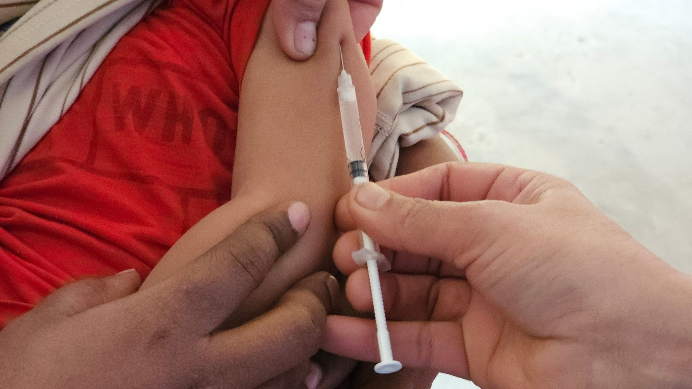

In 2026, Bangladesh has been hit by its largest measles outbreak on record. By 10 November, health authorities had counted **more than 244,000 suspected cases and 1,299 deaths**, almost all of them children. Just a few years ago, the same country was close to eliminating measles altogether.

What went wrong there can happen anywhere, including here in Tanzania. This article explains what measles is, how it develops in the body, and the simple steps that keep a child safe.

## What Is Measles?

Measles is a viral infection caused by the measles virus. It is one of the most contagious diseases known to humankind. According to the World Health Organization (WHO):

- The virus spreads through coughing, sneezing and simply **breathing the same air** as an infected person.
- It can stay alive in the air or on surfaces **for up to two hours** after the sick person has left the room.
- One infected person can pass it on to **up to 18 other people** who are not protected.
- A person can spread measles **four days before the rash appears** and up to four days after, often before anyone knows they are sick.

Measles is not "just a childhood rash." WHO estimates it killed about **95,000 people in 2024**, most of them children under five.

## How Measles Develops in the Body

Measles follows a clear pattern, which helps parents recognise it early.

1. **Silent stage (7 to 14 days):** After the virus enters through the nose or throat, nothing shows for one to two weeks while it multiplies.
2. **Early signs (4 to 7 days):** High fever, runny nose, cough, and red, watery eyes. Tiny white spots may appear inside the cheeks.
3. **The rash (3 to 5 days after the first signs):** A red, blotchy rash starts on the face and behind the ears, then spreads down to the chest, arms and legs over about three days. It usually lasts four to eight days.
4. **Recovery or complications:** Most children recover in two to three weeks, but some develop serious problems.

## Why Measles Can Kill

The danger of measles lies in its complications. WHO lists:

- **Pneumonia** (the most common cause of measles deaths in children)
- **Severe diarrhoea and dehydration**
- **Ear infections** that can lead to hearing loss
- **Blindness**, especially in children lacking vitamin A
- **Encephalitis** (swelling of the brain)
- Miscarriage or premature birth when a pregnant woman is infected

Measles also weakens the immune system for months afterwards, leaving a child open to other infections. The children most at risk of dying are those under five, those who are **malnourished or short of vitamin A**, and those whose immunity is already weak.

## What Happened in Bangladesh?

Bangladesh was once a success story in childhood immunisation. Researchers writing in the CDC's *Emerging Infectious Diseases* journal link the 2026 resurgence to **political instability in 2024 and 2025 that disrupted routine vaccination**. WHO has also pointed to **shortages of measles–rubella vaccine** and the lack of a nationwide catch-up campaign since 2020.

The outcome shows exactly who measles targets. According to UNICEF data:

- **81% of cases** were children under five.
- **34%** were babies younger than nine months, too young for their first vaccine dose.
- **72%** of sick children had never received a single dose of measles vaccine, and 16% had received only one.

In other words, the outbreak spread through the gaps: children who missed their vaccines, and babies who depended on everyone around them being protected.

## How to Prevent Measles

### 1. Vaccinate: two doses, on time

The measles vaccine is safe, cheap and highly effective. Two doses give lifelong protection to almost every child.

In Tanzania, the measles–rubella (MR) vaccine is part of the routine childhood schedule:

- **First dose (MR1): at 9 months**
- **Second dose (MR2): at 18 months**

Many children get the first dose but miss the second. Check your child's clinic card today. If a dose was missed, take the child to the nearest health facility; it is not too late to catch up.

### 2. Protect babies too young to vaccinate

Babies are born with some protection from their mother's antibodies, but it fades fast. Studies show most babies have lost it by about six months, leaving a gap before the 9-month dose. During that gap, the baby is protected mainly by the people around them. Make sure older siblings, parents and caregivers are vaccinated.

**Does breastfeeding help?** Breastfeeding is one of the best things you can do for a baby's overall health and nutrition, and well-nourished children are less likely to get severe measles. However, breast milk does not reliably prevent measles. It works alongside the vaccine, never instead of it.

### 3. Build strong, well-nourished children

Good nutrition does not stop the virus, but it strongly affects how a child copes with it. Give children a varied diet rich in **vitamin A** (orange and yellow fruits and vegetables such as pawpaw, mango, carrots and sweet potatoes, plus dark green leaves like spinach and amaranth/mchicha), and attend vitamin A supplementation days at the clinic.

You can read more about everyday steps for a stronger body in our article on [boosting your immune system](/blog-18.html).

### 4. Act quickly if you suspect measles

- **Keep the child at home** and away from other children, babies and pregnant women.
- **Go to a health facility promptly.** WHO recommends **vitamin A doses** for children with measles, which reduce the risk of blindness and death. Health workers also treat complications such as pneumonia and ear infections.
- **Give plenty of fluids** and keep breastfeeding or feeding the child small, frequent meals.
- **Seek urgent care** if the child has difficulty breathing, will not drink, has diarrhoea with signs of dehydration, becomes very drowsy, or has a convulsion.

## What About Herbal Remedies?

As a licensed traditional and alternative medicine clinic, we are often asked whether herbs can prevent or cure measles. Our honest answer: **no herb has been shown to prevent measles, and there is no herbal cure for it.** The vaccine is the only proven prevention.

Natural approaches can play a supporting role, such as good nutrition, fluids, rest and gentle soothing drinks for a sore throat, but they must never delay a visit to a health facility or replace vaccination.

## The Lesson From Bangladesh

Bangladesh did not lose ground because measles changed. It lost ground because vaccination slipped for a few years, and the virus found the children who were left unprotected. Every missed dose is an open door.

Check your child's clinic card. Talk to your family and neighbours. Two doses of measles vaccine, given on time, can save a life.

## Stay Informed With Herbal Impact

For more practical health guidance, download our free **Herbal Impact Products & Services Guide** from the [Downloads page](/downloads.html), or talk to us:

Call/WhatsApp **+255 754 281 131 / +255 655 281 131**

Or visit us at Herbal Impact, Mosque Street, Kitumbini, Dar es Salaam (opposite the Sunni Mosque).

*Sources: WHO measles fact sheet; Directorate General of Health Services (DGHS), Bangladesh, as reported by The Business Standard, 12 Nov 2026; Emerging Infectious Diseases, Vol. 32, No. 11 (Nov 2026); UNICEF data as cited in Discover Public Health (2026).*

*Herbal Impact is a traditional and alternative medicine clinic licensed by Tanzania's Traditional and Alternative Health Practice Council. This article is for general information and does not replace advice from a qualified health worker.*
