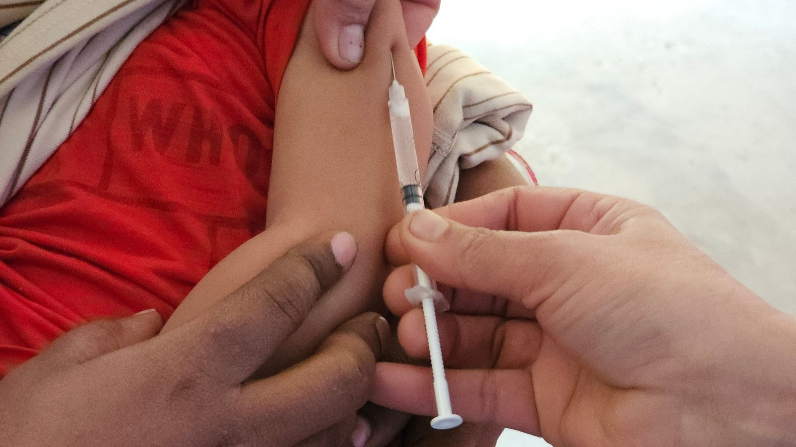

Mwaka huu wa 2026, Bangladesh inakabiliwa na mlipuko mkubwa zaidi wa surua kuwahi kurekodiwa nchini humo. Hadi tarehe 10 Novemba, mamlaka za afya zilikuwa zimehesabu **wagonjwa zaidi ya 244,000 wanaoshukiwa kuwa na surua na vifo 1,299**, na karibu wote waliokufa ni watoto. Cha kushangaza ni kwamba miaka michache tu iliyopita, nchi hiyohiyo ilikuwa karibu kuutokomeza kabisa ugonjwa huu.

Kilichotokea Bangladesh kinaweza kutokea popote, hata hapa kwetu Tanzania. Katika makala hii tutaangalia surua ni nini, inavyojitokeza mwilini, na hatua rahisi za kumlinda mtoto wako.

## Surua ni Nini?

Surua ni ugonjwa unaosababishwa na virusi vya surua, na ni mmoja wa magonjwa yanayoambukiza kwa kasi kuliko yote duniani. Shirika la Afya Duniani (WHO) linaeleza kwamba:

- Virusi husambaa mgonjwa anapokohoa, anapopiga chafya, au hata kwa **kuvuta hewa ileile** aliyoivuta.
- Virusi vinaweza kuendelea kuishi hewani au juu ya vitu **hadi saa mbili** baada ya mgonjwa kuondoka chumbani.
- Mgonjwa mmoja anaweza kuwaambukiza **hadi watu 18** ambao hawajakingwa.
- Mtu anaweza kuambukiza wengine **siku nne kabla vipele havijatokea** hadi siku nne baada ya kutokea. Mara nyingi huwa anaambukiza kabla mtu yeyote hajajua kuwa ni mgonjwa.

Surua si "vipele vya kawaida vya utotoni." Kwa makadirio ya WHO, iliua takriban **watu 95,000 mwaka 2024**, wengi wao wakiwa watoto chini ya miaka mitano.

## Surua Inavyojitokeza Mwilini

Surua ina mfuatano unaoeleweka, na kuujua kunamsaidia mzazi kuitambua mapema.

1. **Kipindi cha kimya (siku 7 hadi 14):** Virusi vikishaingia kupitia pua au koo, hakuna dalili yoyote kwa wiki moja hadi mbili huku vikizaliana mwilini.
2. **Dalili za mwanzo (siku 4 hadi 7):** Homa kali, mafua, kikohozi, na macho mekundu yanayotoa machozi. Vidoti vidogo vyeupe vinaweza kuonekana ndani ya mashavu.
3. **Vipele (siku 3 hadi 5 baada ya dalili za mwanzo):** Vipele vyekundu huanzia usoni na nyuma ya masikio, kisha huteremka kifuani, mikononi na miguuni ndani ya siku tatu hivi. Kwa kawaida hudumu siku nne hadi nane.
4. **Kupona au madhara zaidi:** Watoto wengi hupona ndani ya wiki mbili hadi tatu, lakini baadhi hupatwa na madhara makubwa.

## Kwa Nini Surua Huua?

Hatari kubwa ya surua iko kwenye madhara yanayoifuata. WHO inayataja kuwa ni:

- **Nimonia (homa ya mapafu)**, ambayo ndiyo chanzo kikuu cha vifo vya watoto wenye surua
- **Kuhara sana na kupungukiwa maji mwilini**
- **Maambukizi ya masikio** yanayoweza kusababisha uziwi
- **Upofu**, hasa kwa watoto wenye upungufu wa vitamini A
- **Kuvimba kwa ubongo**
- Mimba kuharibika au mtoto kuzaliwa kabla ya wakati, iwapo mama mjamzito ataambukizwa

Zaidi ya hayo, surua hudhoofisha kinga ya mwili kwa miezi kadhaa baadaye, hivyo mtoto anakuwa rahisi kushambuliwa na magonjwa mengine. Walio hatarini zaidi kufariki ni watoto chini ya miaka mitano, watoto **wenye utapiamlo au upungufu wa vitamini A**, na wale ambao kinga zao tayari ni dhaifu.

## Nini Kimetokea Bangladesh?

Kwa miaka mingi Bangladesh ilisifika kwa mafanikio yake katika chanjo za watoto. Watafiti walioandika kwenye jarida la *Emerging Infectious Diseases* la CDC wanahusisha mlipuko huu na **machafuko ya kisiasa ya mwaka 2024 na 2025 yaliyovuruga huduma za chanjo za kawaida**. WHO nayo imetaja **uhaba wa chanjo ya surua na rubela** pamoja na kutokuwepo kwa kampeni ya chanjo ya kitaifa tangu mwaka 2020.

Takwimu za UNICEF zinaonyesha wazi surua inawalenga akina nani:

- **Asilimia 81** ya wagonjwa ni watoto chini ya miaka mitano.
- **Asilimia 34** ni watoto wachanga chini ya miezi tisa, ambao bado hawajafikia umri wa kupata dozi ya kwanza.
- **Asilimia 72** ya watoto walioumwa hawakuwahi kupata chanjo yoyote ya surua, na asilimia 16 walipata dozi moja tu.

Kwa maneno mengine, ugonjwa ulipenya kupitia mianya: watoto waliokosa chanjo, na watoto wachanga waliotegemea watu wanaowazunguka wawe wamekingwa.

## Jinsi ya Kujikinga na Surua

### 1. Mpe mtoto chanjo: dozi mbili, kwa wakati

Chanjo ya surua ni salama, ni nafuu, na inafanya kazi kwa kiwango cha juu sana. Dozi mbili humpa karibu kila mtoto kinga ya maisha yote.

Hapa Tanzania, chanjo ya surua na rubela (MR) ni sehemu ya ratiba ya kawaida ya chanjo za watoto:

- **Dozi ya kwanza (MR1): akiwa na miezi 9**
- **Dozi ya pili (MR2): akiwa na miezi 18**

Watoto wengi hupata dozi ya kwanza lakini hukosa ya pili. Angalia kadi ya kliniki ya mtoto wako leo. Kama kuna dozi aliyoikosa, mpeleke kituo cha afya kilicho karibu. Bado hujachelewa.

### 2. Walinde watoto ambao bado ni wadogo kwa chanjo

Mtoto huzaliwa na kinga kidogo aliyoipata kutoka kwa mama yake, lakini kinga hiyo hupungua haraka. Tafiti zinaonyesha kwamba watoto wengi wanakuwa wameipoteza kufikia miezi sita hivi, hivyo kunabaki pengo kabla ya dozi ya miezi tisa. Katika kipindi hicho, kinga kubwa ya mtoto ni watu wanaomzunguka. Hakikisha kaka na dada zake, wazazi na walezi wote wamepata chanjo.

**Je, kunyonyesha kunasaidia?** Maziwa ya mama ni kati ya zawadi bora kabisa kwa afya na lishe ya mtoto, na mtoto mwenye lishe bora hapatwi na surua kali kwa urahisi. Hata hivyo, maziwa ya mama hayawezi kumzuia mtoto kupata surua kwa uhakika. Kunyonyesha kunafanya kazi pamoja na chanjo, si badala yake.

### 3. Jenga watoto wenye afya na lishe bora

Lishe bora haiwezi kuzuia virusi, lakini inaamua kwa kiasi kikubwa jinsi mtoto atakavyoweza kuhimili ugonjwa. Mpe mtoto vyakula mbalimbali vyenye **vitamini A** kwa wingi, kama papai, embe, karoti, viazi vitamu vya rangi ya chungwa, pamoja na mboga za majani zenye rangi ya kijani iliyokolea kama mchicha. Pia hudhuria siku za kupewa matone ya vitamini A kliniki.

Unaweza pia kusoma makala yetu kuhusu [kuimarisha kinga za mwili](/blog-18-sw.html) kwa hatua za kila siku.

### 4. Chukua hatua haraka ukishuku surua

- **Mbakize mtoto nyumbani** na umweke mbali na watoto wengine, watoto wachanga na wajawazito.
- **Mpeleke kituo cha afya mapema.** WHO inashauri watoto wenye surua wapewe **dozi za vitamini A**, ambazo hupunguza hatari ya upofu na kifo. Wahudumu wa afya pia watatibu madhara kama nimonia na maambukizi ya masikio.
- **Mpe maji ya kunywa kwa wingi**, endelea kumnyonyesha, au mpe chakula kidogokidogo mara kwa mara.
- **Tafuta msaada wa haraka** kama mtoto anapumua kwa shida, anakataa kunywa, anaharisha na kuonyesha dalili za kukauka mwili, analegea sana au anapata degedege.

## Je, Dawa za Asili Zinasaidia?

Kama kliniki ya tiba asili na tiba mbadala iliyosajiliwa, mara nyingi tunaulizwa kama mitishamba inaweza kuzuia au kutibu surua. Jibu letu la kweli ni hili: **hakuna dawa ya mitishamba iliyothibitishwa kuzuia surua, na hakuna tiba ya asili ya surua.** Chanjo ndiyo kinga pekee iliyothibitishwa.

Njia za asili zinaweza kusaidia pembeni, kama lishe bora, maji ya kutosha, mapumziko na vinywaji laini vya kutuliza koo, lakini kamwe zisichelewesha safari ya kwenda kituo cha afya wala zisichukue nafasi ya chanjo.

## Somo Kutoka Bangladesh

Bangladesh haikurudi nyuma kwa sababu surua imebadilika. Ilirudi nyuma kwa sababu chanjo zililegea kwa miaka michache, na virusi vikawapata watoto walioachwa bila kinga. Kila dozi inayokosekana ni mlango ulio wazi.

Angalia kadi ya kliniki ya mtoto wako. Zungumza na familia yako na majirani zako. Dozi mbili za chanjo ya surua, zikitolewa kwa wakati, zinaweza kuokoa maisha.

## Endelea Kujifunza na Herbal Impact

Kwa ushauri zaidi wa afya, pakua bure **Mwongozo wa Bidhaa na Huduma za Herbal Impact** kwenye [ukurasa wa Downloads](/downloads.html), au wasiliana nasi:

Simu/WhatsApp **0754 281 131 / 0655 281 131**

AU

Tutembelee: mtaa wa Mosque, Kitumbini, Dar es Salaam (mkabala na msikiti wa Sunni).

*Vyanzo: Taarifa ya WHO kuhusu surua; Kurugenzi Kuu ya Huduma za Afya (DGHS) Bangladesh, kama ilivyoripotiwa na The Business Standard, 12 Nov 2026; jarida la Emerging Infectious Diseases, Toleo 32, Na. 11 (Nov 2026); takwimu za UNICEF kama zilivyonukuliwa na jarida la Discover Public Health (2026).*

*Herbal Impact ni kliniki ya tiba asili na tiba mbadala iliyosajiliwa na Baraza la Tiba Asili na Tiba Mbadala Tanzania. Makala hii ni kwa ajili ya kutoa elimu ya jumla na haichukui nafasi ya ushauri wa mhudumu wa afya aliyesomea.*
