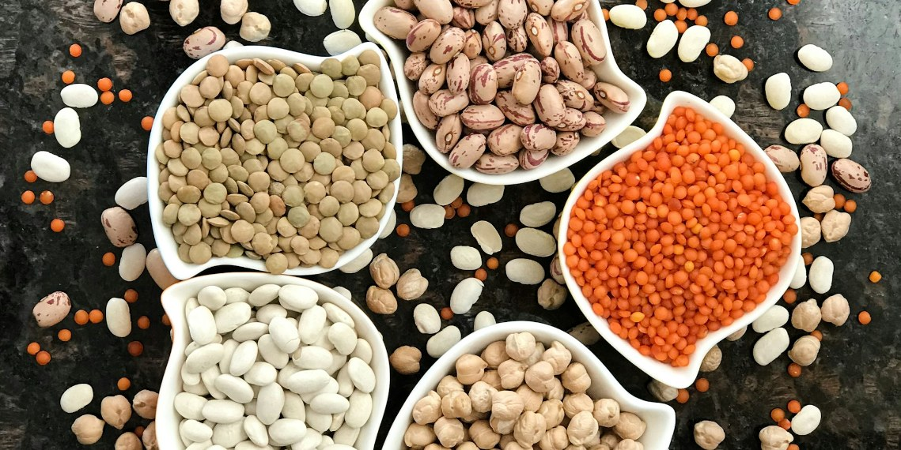

Watu wawili wanaweza kuwa wamezaliwa mwaka mmoja, lakini miili yao ikatofautiana kwa miaka kadhaa. Mmoja hupanda ngazi bila shida, hulala vizuri na huugua mara chache. Mwingine huchoka haraka, hutumia dawa za aina kadhaa na huonekana mzee kuliko umri wake.

Tofauti hiyo inaitwa **umri wa kibaiolojia**: hali halisi ya mwili wako kwa ndani, si idadi ya miaka tangu ulipozaliwa. Habari njema ni kwamba, kwa mujibu wa tafiti, umri wa kibaiolojia haujafungwa. Tabia zako za kila siku zinachangia kasi ambayo saa ya mwili wako inazeeka. Katika makala hii nitakueleza umri wa kibaiolojia ni nini, wanasayansi wanaupimaje, na tabia zipi zinahusishwa na kuzeeka taratibu.

## Umri wa Kibaiolojia ni Nini?

**Umri wa kuzaliwa** ni miaka uliyoishi tangu ulipozaliwa. **Umri wa kibaiolojia** unaonyesha hali ya seli, mishipa ya damu, misuli na viungo vyako. Mtu mwenye miaka 50 anaweza kuwa na mwili wa mtu wa miaka 45, au wa mtu wa miaka 60.

Leo wanasayansi wana njia kadhaa za kuukadiria:

- **Saa za epijenetiki.** DNA yako ina alama ndogo za kikemikali zinazowasha na kuzima jeni. Mpangilio wa alama hizi hubadilika kadiri umri unavyoongezeka, kwa hiyo kipimo cha damu kinaweza kuusoma na kukadiria umri wako wa kibaiolojia au kasi unayozeeka.
- **Telomia.** Hivi ni vifuniko vinavyolinda ncha za kromosomu, kama plastiki zilizo kwenye ncha za kamba za viatu. Hufupika kila seli inapojigawa, na telomia fupi huhusishwa na umri mkubwa wa kibaiolojia.
- **Vipimo vya kawaida vya mwili.** Shinikizo la damu, sukari ya damu, lehemu, mzunguko wa kiuno na nguvu za misuli vyote vinaonyesha jinsi mwili unavyozeeka.

## Tafiti Zinasema Nini?

Vinasaba (jeni) vina mchango wake, lakini mtindo wa maisha una nafasi kubwa. Hizi ni baadhi ya tafiti muhimu:

- **Kula kidogo kuliko kawaida.** Katika jaribio la CALERIE, watu wazima wenye afya waliopunguza kiasi cha kalori kwa miaka miwili walipunguza kasi ya kuzeeka kwa takriban asilimia 2 hadi 3, ikipimwa kwa saa ya epijenetiki (*Nature Aging*, 2023). Watafiti wanaeleza kuwa matokeo ya ukubwa huu yamehusishwa katika tafiti nyingine na kupungua kwa hatari ya kifo kwa asilimia 10 hadi 15.
- **Omega-3 kutoka kwa samaki.** Katika jaribio la DO-HEALTH la miaka mitatu kwa wazee, virutubisho vya omega-3 vilipunguza kasi ya saa kadhaa za epijenetiki kwa hadi takriban miezi minne. Mchanganyiko wa omega-3, vitamini D na mazoezi rahisi ya nyumbani ulileta faida kubwa zaidi (*Nature Aging*, 2025).
- **Kujishughulisha.** Utafiti wa watu wazima 5,823 nchini Marekani ulionyesha kuwa watu wanaofanya mazoezi kwa kiwango cha juu walikuwa na telomia zinazolingana na takriban miaka tisa pungufu ya kuzeeka kwa seli, ukilinganisha na wasiofanya mazoezi (*Preventive Medicine*, 2017).

Tuwe wakweli kuhusu ukubwa wa matokeo haya: ni halisi lakini ya kiasi, mara nyingi miezi kadhaa katika kipindi cha miaka michache. Lakini yanajumlishana, yanasaidiana, na tabia hizohizo pia hupunguza hatari ya magonjwa ya moyo, kisukari, kiharusi na baadhi ya saratani.

## Tabia Saba za Kupunguza Kasi ya Kuzeeka

**1. Jishughulishe kila siku.** Lenga angalau dakika 150 kwa wiki za kutembea haraka au shughuli kama hiyo, kiwango cha chini kinachopendekezwa na Shirika la Afya Duniani. Mwendo wa haraka ni ule unaokuwezesha kuongea lakini si kuimba.

**2. Imarisha misuli yako.** Mazoezi mafupi ya nguvu mara mbili kwa wiki (kuinuka kitini na kukaa, push-up za ukutani, kunyanyua visigino) hulinda sukari ya damu, mifupa na uwiano wa mwili. Huhitaji gym.

**3. Kula zaidi vyakula vya mimea.** Jaza nusu ya sahani yako kwa mboga na matunda. Kula maharage, dengu au jamii nyingine ya kunde siku nyingi za wiki, na chagua nafaka zisizokobolewa kama ulezi, mtama, shayiri na mchele wa kahawia badala ya unga mweupe.

**4. Kula samaki wenye mafuta mara mbili kwa wiki.** Dagaa, sadini, kibua na samoni wote wanafaa, wawe wabichi, wa kugandishwa au wa kopo.

**5. Lala saa 7 hadi 9.** Weka muda maalumu wa kulala na kuamka. Usingizi mfupi na usio na mpangilio huhusishwa na kuzeeka haraka.

**6. Epuka tumbaku na punguza pombe.** Uvutaji sigara ni mojawapo ya vitu vinavyoongeza kasi ya kuzeeka kuliko vyote. Unywaji mwingi wa pombe nao unahusishwa na umri mkubwa wa kibaiolojia.

**7. Dhibiti msongo wa mawazo na endelea kuungana na wengine.** Msongo wa muda mrefu huhusishwa na telomia fupi, na upweke huhusishwa na afya duni. Dakika chache za kupumua taratibu kila siku, na muda wa mara kwa mara na watu muhimu kwako, vyote husaidia.

## Uko Wapi Leo? Kipimo Rahisi cha Kiuno

Kipimo kimoja rahisi unachoweza kufanya nyumbani ni kiuno chako. Pima mzunguko wa kiuno usawa wa kitovu, ukiwa umetoa pumzi kawaida, kisha linganisha na urefu wako. **Kiuno kisichozidi nusu ya urefu wako** ni lengo la afya linalotumika sana. Kama umezidi, tabia zilizoelezwa hapo juu ni mahali pazuri pa kuanzia.

## Geuza Maarifa Haya Kuwa Mpango wa Siku 30

Kujua cha kufanya ni jambo moja; kukifanya kila siku ni jambo jingine. Ndiyo sababu nimeandika kitabu **Punguza Kasi ya Kuzeeka: Mpango wa Siku 30 Unaotegemea Utafiti wa Kisayansi**, kitabu chenye picha kinachogeuza tafiti hizi kuwa kazi moja ndogo kila siku. Ndani yake utapata:

- **Kipimo cha Saa ya Uzee**, kujua ulipo Siku ya 1 na umefika wapi Siku ya 30
- **Mpango wa wiki 4 hatua kwa hatua** unaogusa usingizi, mazoezi, chakula, nguvu za misuli, msongo wa mawazo na mahusiano
- **Mwongozo wa vyakula** wenye jedwali la mbadala kwa bajeti yoyote, ratiba ya milo ya siku 7 na orodha ya manunuzi, kwa vyakula vinavyopatikana karibu kila mahali
- **Mazoezi rahisi ya nguvu** ya kufanya nyumbani na **majedwali ya kufuatilia** ya kuchapisha

Kitabu kinauzwa **US$15** na kinapatikana kwa Kiswahili na kwa Kiingereza. **Kifurushi cha Premium (US$29)** kinaongeza mapishi 30 ya kuzeeka taratibu, jedwali la Excel linalojihesabu na zana za Word za kujaza.

**[Pata kitabu kupitia Payhip](https://payhip.com/b/PVIow)** au **[kupitia Gumroad](https://wellbiz8.gumroad.com/l/xbwrhq)**

**[Pata Kifurushi cha Premium kupitia Payhip](https://payhip.com/b/rOAP9)** au **[kupitia Gumroad](https://wellbiz8.gumroad.com/l/apohis)**

## Maswali Yanayoulizwa Mara kwa Mara

**Kuna tofauti gani kati ya umri wa kibaiolojia na umri wa kuzaliwa?** Umri wa kuzaliwa ni idadi ya miaka tangu ulipozaliwa. Umri wa kibaiolojia unaonyesha jinsi seli na viungo vyako vinavyoendelea kufanya kazi, na unaweza kuwa mdogo au mkubwa kuliko umri wako wa kuzaliwa kutegemea vinasaba na mtindo wa maisha.

**Je, kweli unaweza kupunguza umri wako wa kibaiolojia?** Tafiti zinaonyesha kuwa tabia nzuri zinaweza kupunguza kasi ya kuzeeka kibaiolojia, na baadhi ya tafiti zinaonyesha vipimo fulani vikiboreka. Matokeo ya badiliko moja ni ya kiasi, lakini kuunganisha tabia kadhaa kwa miaka huleta tofauti kubwa zaidi.

**Nitajuaje umri wangu wa kibaiolojia?** Ni kipimo cha maabara pekee, kama kipimo cha damu cha saa ya epijenetiki, kinachoweza kuukadiria moja kwa moja. Nyumbani, vipimo rahisi kama uwiano wa kiuno na urefu, shinikizo la damu, sukari ya damu na ukakamavu wa mwili vinatoa dalili muhimu.

**Je, virutubisho vinarudisha nyuma uzee?** Hakuna kirutubisho chenye ushahidi imara kwamba kinarudisha nyuma uzee. Kuwa makini na yeyote anayeahidi hivyo. Chakula, mazoezi, usingizi na kuepuka tumbaku vina ushahidi bora zaidi.

## Wasiliana Nasi

Kwa maelezo zaidi au ushauri, piga simu au WhatsApp **0754 281 131** / **0655 281 131**, au tutembelee **Mtaa wa Mosque, Kitumbini, Dar es Salaam** (mkabala na msikiti wa Sunni).

*Vyanzo: Waziry na wenzake, Effect of long-term caloric restriction on DNA methylation measures of biological aging in healthy adults from the CALERIE trial (Nature Aging, 2023); Bischoff-Ferrari na wenzake, Individual and additive effects of vitamin D, omega-3 and exercise on DNA methylation clocks of biological aging in older adults from the DO-HEALTH trial (Nature Aging, 2025); Tucker, Physical activity and telomere length in U.S. men and women (Preventive Medicine, 2017); Shirika la Afya Duniani, Guidelines on physical activity and sedentary behaviour (2020).*

*Makala hii ni kwa ajili ya elimu ya jumla na si ushauri wa kitabibu. Herbal Impact imesajiliwa na Baraza la Tiba Asili na Tiba Mbadala la Tanzania. Kama uko kwenye matibabu, endelea nayo na zungumza na daktari wako kabla ya kubadilisha mlo au mazoezi yako.*
