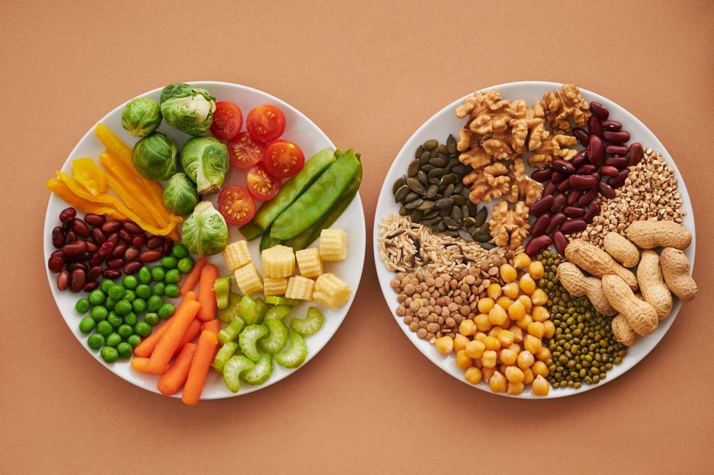

"Daktari, nimeambiwa nina kisukari. Sasa nile nini?" Hili ni swali ninaloulizwa karibu kila wiki. Wengi huambiwa waache sukari, lakini hawaelezwi kuhusu ugali, wali, ndizi, viazi au matunda. Matokeo yake, wengine huacha vyakula vingi bila sababu, na wengine huendelea kula vile vile huku sukari ikiendelea kupanda.

Kuchagua vyakula bora kwa mgonjwa wa kisukari si jambo la kubahatisha. Kuna kipimo rahisi kinachoitwa **Kielelezo cha Glycemic**, kwa kifupi **GI**, ambacho kinakuonyesha chakula kipi hupandisha sukari haraka na kipi huipandisha taratibu. Katika makala hii nitakueleza kwa ufupi jinsi kinavyofanya kazi.

## Kwa Nini Chakula Ndicho Msingi wa Kudhibiti Kisukari?

Unapokula vyakula vya wanga au sukari, mwili huvigeuza kuwa glukosi inayoingia kwenye damu. Homoni ya insulini ndiyo hufungua mlango ili glukosi iingie kwenye seli. Kwa mwenye kisukari aina ya pili, seli haziitikii insulini vizuri, hivyo sukari hubaki kwenye damu.

Sukari ikikaa juu kwa muda mrefu huharibu mishipa ya damu na ya fahamu taratibu. Hapo ndipo matatizo kama magonjwa ya moyo, kiharusi, figo kushindwa kufanya kazi, matatizo ya macho na vidonda vya miguu visivyopona huanzia.

Dawa za hospitali zinasaidia sana, na wengi wanazihitaji. Hata hivyo uwezo wake una mipaka, na baadhi huleta madhara ya pembeni baada ya miaka mingi. Kwa uzoefu wangu, **silaha kubwa zaidi ni kile unachokiweka kwenye sahani yako**, kwa sababu ndicho kinachoamua sukari yako itapanda kiasi gani baada ya kila mlo.

## Kielelezo cha Glycemic (GI) ni Nini?

GI ni kipimo chenye namba kuanzia 0 hadi 100. Kinapanga vyakula vyenye wanga kulingana na kasi yake ya kupandisha sukari kwenye damu, ukilinganisha na glukosi tupu ambayo imepewa namba 100.

- **GI ya chini (55 au chini):** chakula humeng'enywa taratibu na sukari hupanda kwa upole. Mifano: maharage, adesi, dengu, choroko, oti zilizobanwa, tufaha, chungwa na maziwa.
- **GI ya kati (56 hadi 69):** sukari hupanda kiasi. Mifano: viazi vitamu, wali wa brown, ugali wa dona na nanasi.
- **GI ya juu (70 au zaidi):** chakula humeng'enywa haraka na sukari hupanda kwa kasi. Mifano: mkate mweupe, wali mweupe, viazi mviringo vya kuchemsha, mihogo ya kuchemsha na tikiti maji.

Kanuni ni rahisi: milo yako mingi iwe ya vyakula vya GI ya chini, vya GI ya kati vile kwa kiasi, na vya GI ya juu viwe kidogo na vya mara chache.

## Mambo Matatu Yanayowashangaza Wengi

**Kwanza, mkate wa brown si lazima uwe bora.** Mkate wa ngano isiyokobolewa (GI 74) hupandisha sukari karibu sawa na mkate mweupe (GI 75). Mkate wenye nafaka nzima na mbegu (GI takriban 53) ni chaguo bora zaidi.

**Pili, namna ya kupika hubadilisha mambo.** Uji wa oti wa papo hapo una GI ya 79, lakini uji wa oti zilizobanwa ni takriban 55. Ndizi mbichi za kupika (GI takriban 37) ni rafiki zaidi kwa sukari kuliko ndizi zilizoiva sana.

**Tatu, unachokula pamoja nacho ni muhimu kuliko unavyodhani.** Utafiti wa vyakula vya asili nchini Kenya ulionyesha kuwa wali mweupe peke yake una GI ya 77, lakini ukiliwa **pamoja na maharage** hushuka hadi 62. Ugali wa dona peke yake ulikuwa na GI ya 62, lakini ukiliwa na mboga ya majani ya kunde mlo mzima ulishuka hadi 45. Mboga, protini na nyuzilishe hupunguza kasi ya sukari kuingia kwenye damu.

## Chakula Ninachokipendekeza Kila Siku

Ningeruhusiwa kumpa mwenye kisukari ushauri mmoja tu, ningemwambia: **kula vyakula vya jamii ya kunde kila siku.** Maharage, adesi, dengu, njegere, choroko, kunde na mbaazi kwa sehemu kubwa vina GI kati ya takriban 15 na 45. Vinashibisha, vina protini na nyuzilishe kwa wingi, bei yake ni nafuu na vinapatikana karibu kila mahali.

Anza hivi:

1. Badilisha nusu ya wali kwenye sahani yako kwa maharage au adesi.
2. Anza mlo mkuu kwa bakuli dogo la supu ya maharage.
3. Badala ya biskuti, tafuna karanga chache au dengu za kukaanga.
4. Jaza nusu ya sahani kwa mboga, robo kwa protini, na robo iliyobaki kwa chakula cha wanga cha GI ya chini.

## Tahadhari Muhimu Kuhusu Dawa

Ukianza kula kwa mtindo huu, sukari yako inaweza kushuka. Hilo ni jambo jema, lakini kama unatumia insulini au vidonge kama glibenclamide au gliclazide, sukari inaweza kushuka kupita kiasi. **Usiache wala usipunguze dawa za kisukari bila ushauri wa daktari.** Pima sukari mara nyingi zaidi na umruhusu daktari wako akurekebishie dozi.

## Pata Mwongozo Kamili: Mwongozo wa Lishe kwa Mwenye Kisukari

Ili ufaidike na elimu hii kila siku, nimeandaa **Mwongozo wa Lishe kwa Mwenye Kisukari**, kitabu pepe (PDF) chenye kurasa 24 na picha, kwa ajili ya wenye kisukari aina ya pili, walio hatarini kukipata, pamoja na familia zinazowapikia. Ndani yake utapata:

- **Jedwali la GI la vyakula zaidi ya 70** vinavyoliwa kila siku duniani, vikiwa vimepangwa kwa rangi: chini, kati na juu
- **Kanuni ya sahani** na jedwali la **mbadala wa vyakula**
- **Mpango wa milo wa siku 7**
- **Mapishi sita rahisi** ya maharage, adesi, dengu, choroko na mboga za majani
- Mazoea ya kila siku yanayoshusha sukari, jinsi ya kutambua na kukabiliana na **sukari ikishuka sana**, **orodha ya manunuzi** na **kadi ya kumbukumbu** ya ukurasa mmoja

Bei yake ni **TZS 20,000 (US$7.55)**. Kinapatikana kwa Kiswahili na pia kwa Kiingereza.

**[Pata Mwongozo wa Lishe kwa Mwenye Kisukari kupitia Payhip](PAYHIP_LINK_SW)** au **[kupitia Gumroad](GUMROAD_LINK_SW)**

Pamoja na lishe bora na huduma ya daktari, baadhi ya wateja wetu pia hutumia **Haiiba GlucoMaster Extra**, dawa ya mimeatiba kutoka Herbal Impact. Uliza kuhusu dawa hii, na mjulishe daktari wako kuhusu dawa yoyote ya mimeatiba unayotumia.

## Maswali Yanayoulizwa Mara kwa Mara

**Ni vyakula gani bora kwa mgonjwa wa kisukari?** Jamii ya kunde (maharage, adesi, dengu, choroko), mboga za majani, oti zilizobanwa, shayiri, matunda mazima kama tufaha na chungwa, maziwa, mtindi usio na sukari na karanga ni miongoni mwa machaguo bora. Kula vyakula vya wanga pamoja na mboga na protini ili kupunguza athari ya mlo mzima.

**Je, mgonjwa wa kisukari anaweza kula ugali au wali?** Ndiyo, lakini kwa kiasi kidogo, pamoja na mboga za majani na maharage au samaki. Wali uliochanganywa na maharage ni bora kuliko wali mtupu, na ugali uliwe pamoja na mboga za majani.

**Je, matunda yanafaa kwa mwenye kisukari?** Matunda mengi mazima yana GI ya chini na yanafaa yakiliwa kwa kiasi cha kawaida. Tikiti maji na matunda yaliyoiva kupita kiasi hupandisha sukari haraka zaidi, na ni vyema kuepuka juisi.

**Je, lishe ya GI ya chini inaweza kuchukua nafasi ya dawa?** Hapana. Inasaidia matibabu na inaweza kumwezesha daktari kupunguza dozi baadaye, lakini usiache wala kubadilisha dawa bila ushauri wa daktari. Mwone daktari sukari ikiwa juu sana, ikishuka mara kwa mara, ukipata kidonda mguuni au mabadiliko ya kuona. Wajawazito na watoto wapate ushauri wa mtaalamu kwanza.

## Wasiliana Nasi

Kwa maelezo zaidi au ushauri, piga simu au WhatsApp **0754 281 131** / **0655 281 131**, au tutembelee **Mtaa wa Mosque, Kitumbini, Dar es Salaam** (mkabala na msikiti wa Sunni).

*Vyanzo: Atkinson, Foster-Powell na Brand-Miller, International tables of glycemic index and glycemic load values: 2008 (Diabetes Care); Ebere, Imungi na Kimani, Glycemic index values of traditional Kenyan foods (African Health Sciences, 2021); American Diabetes Association, Diabetes Plate Method.*
