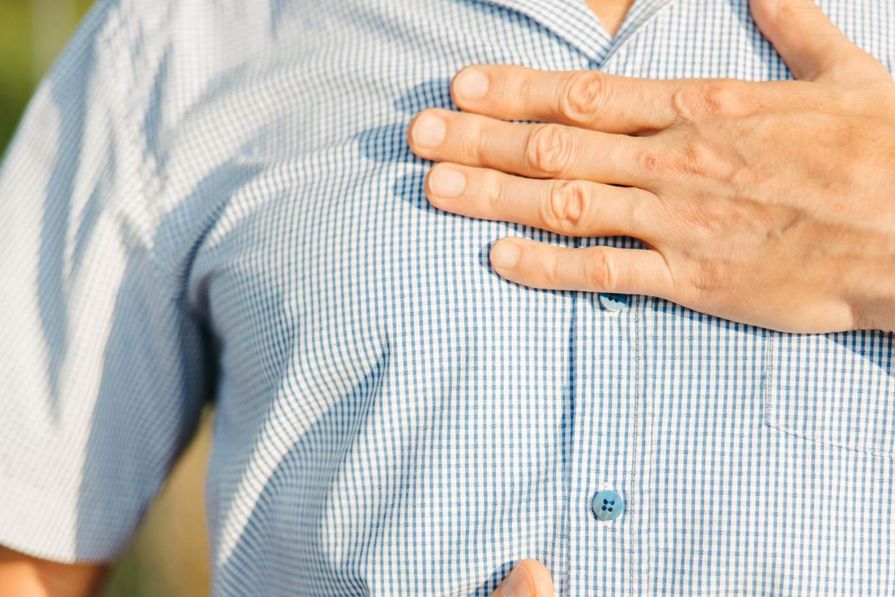

Heartburn is a severe, burning pain in the food pipe that rises from the chest up to the throat. So what causes heartburn? It happens when acid from the stomach flows upwards towards the throat.

## What Causes Heartburn: The Muscle at the Top of the Stomach

This mostly happens when the muscle that closes and opens the food pipe, located where the pipe joins the stomach, fails to close when it should, or does not close 100% of the way.

This muscle is supposed to open when we eat and drink, and to close when we are resting between meals and drinks.

## Simple Home Relief for Mild Heartburn

If the heartburn is not very severe, among the home remedies that can bring relief are licking a little sugar or ash.

## Why Severe Heartburn Is Dangerous

However, if the heartburn is very severe and keeps coming back, it is wise to seek treatment, and to do so quickly.

Severe, long-lasting heartburn does not only greatly spoil your enjoyment of life. It is also one of the risk factors for cancer of the food pipe.

## Do You Need Treatment for Heartburn?

If you are struggling with this condition and need treatment, you can contact us.

Call/WhatsApp **+255 754 281 131 / +255 655 281 131**

Or visit us at Herbal Impact, Mosque Street, Kitumbini, Dar es Salaam (opposite the Sunni Muslim Jamaat mosque).

*Herbal Impact is a traditional and alternative medicine clinic licensed by Tanzania's Traditional and Alternative Health Practice Council. If you are on medical treatment, keep taking it and tell your doctor about any herbal products you use.*
